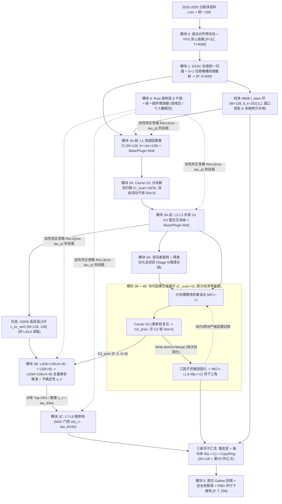

# DCPA-Flat v3.3 架构修订规格书与冻结接口契约

> **文档定位**：本规格书在 `DCPA-Flat v3.2 Master Blueprint` 基础上，正式固化已拍板的全部架构修订（R1–R8），并定义跨工作流（WS-1 至 WS-6）的**唯一冻结接口契约**。所有 Coding Agent 实施前须以此文档为唯一真相源（Single Source of Truth）。  
> **状态**：纯架构规格与接口契约（尚未修改仓库业务代码）。

---

## 1. v3.2 → v3.3 核心架构修订总表

| 编号 | v3.2 原始方案与隐患 | v3.3 正式定案 | 关键收益与硬不变量 |
| :--- | :--- | :--- | :--- |
| **R1** | L1–L8 仅围绕 `K=8` 图槽位做 Cross-Attention，局部 `W=128` 窗口被下放到末端只做词干拷贝，存在窄瓶颈风险 | **保留 3 层 `W=128` 局部窗口注意力**：`L1` 置于 `Carrier G1` **之前**做因果消歧（`0 <= Δs < 128`）；`L4`、`L6` 与 `G2_prior (K=8)` + 常开汇点做 **`265` 列联合单 Softmax**（`1 <= Δs <= 128`） | 算力增量 `< 5%`；近场 1.2 KB 作用域与远场 `K=8` 命题图自动仲裁；`CopyRing` 独占纯 `48 KB` `f_stem` 环零相位污染，默认另加 `32 KB` L3 语义环（总快照 `~114 KB`，支持 `share_stem_ring=True` 切回 `0 KB` 增量） |
| **R2** | 外部插件专家与底座共用 Top-1 竞选池（Sigmoid 原型键），单训插件会“路由劫持”踢掉底座 Top-1，无法真正保证 `0.0` 漂移 | **底座独立 Top-1 + 插件独立加性死区旁路**：底座永久只读并独立运行；外部领域包与个人睡眠包均挂为加性残差分支，门控采用硬死区 $\operatorname{ReLU}(\langle \hat{h}_n, \hat{k}_p \rangle - \tau_p)$（插件池内 Top-1/Top-2） | 非目标域**数学严格 `0.0` 比特漂移 + `0.0` 额外 FLOPs**；多插件可同时叠挂协同（如 Python 底座 + SQL 插件 + 睡眠插件）；底座内部摆脱无分母死专家风险 |
| **R3** | 宣称“闭球内标量门控真收缩 → 强制零 detach”，但 $\sigma_{\text{full}}$ 分母 `0.04`（斜率 `6.25`）及状态依赖门在 400–500 步长文档下仍有雅可比爆炸隐患；`Slot-0 Pinning` 双图语义缺失 | 将 $\sigma_{\text{full}}$ 温控放宽至 `0.10`（峰值斜率 `2.5`），显式加入边张量收缩因子 $\gamma_A \in (0, 0.99]$；**主目标零 detach + 512 步实测校验**，在归并打分器/$\sigma_{\text{full}}$ 输入侧保留可开关安全阀；明确 **`Slot-0` 仅锁 `Carrier G2`** | 防止重演 2026-11-27 百万倍梯度爆炸；`G1` 保持自由流动服务局部语法消歧，`G2` Slot-0 专责立意/前提统领且彻底排除于满载门与归并竞争之外 |
| **R4** | `s = min(S-1, ...)` 会把溢出段/跨文档字节挤进末槽 `639` 造成污染；640 步循环直接 `fullgraph=True` 会引发编译展开爆炸；`HIPR <-> G2` 闭环被画成前馈 DAG | 散射网格多开 1 个**垃圾桶哨兵槽 `S_alloc = S + 1`**，切片丢弃槽 `S` 且屏蔽溢出字节 loss；采用 **`C_scan = 16/32` 静态分块编译** + 按需重算；启用海马体时 `HIPR` 与 `G2` 在块内严格因果交错执行 | 零跨文档溢出污染、零编译展开爆炸、零 CUDAGraph Tree 分叉 OOM；海马体多文档同道混装与逐文档串行推理误差 `< 1e-5` |
| **R5** | L7–L8 认知不确定性 $u_n$ 缺失可微梯度回路；训练用 batch Top-25%、推理用标量阈值 $\bar{\tau}_{\text{think}}$ 存在 Gate 6 对齐隐患 | 为 $u_n$ 增加**双梯度回路**（局部预测难度 Huber 自监督回归 $\mathcal{L}_{\text{unc}}$ + MoD 风格可微残差门控 $\sigma(u_n - \bar{\tau}_{\text{think}})$）；规定 **eval / streaming / Gate 6 强制切阈值模式** | $u_n$ 真正学到难度判定而非随机挑选；Python eval 与 `dcpa-core-rs` 满足 Gate 6（`< 1e-5`）硬对齐 |
| **R6** | `dcpa-sleep-daemon` 要求纯 Rust 更新 8 层非线性专家包，缺少可落地的梯度计算载体 | **架构解耦 + 管线合一**：`dcpa-core-rs` 纯 Rust 零开销录制高 $\beta > 0.25$ 真实片段至 `sleep_replay_ring.bin/.idx` 并热挂载插件；`dcpa-sleep-daemon` 拉起统一端到端插件微调后端（一期 PyTorch MPS/CUDA/CPU，二期可原位换 Candle） | 彻底避免在 `no_std` Rust 手写 8 层全网反传；**社区垂直领域插件训练与个人睡眠巩固 100% 共用同一套格式与训练管线** |
| **R7** | WS-1..4 并行开发前缺少跨模块冻结数据结构契约 | 冻结 6 个核心契约结构体（见第 4 节），开工前先落盘 `dcpa/interfaces.py` | 4 个 Coding Agent 并行开发零形状/语义冲突、WS-5 一次合龙 |
| **R8** | 48M 5k 门禁仅对比旧版 `proto_48m`，无法证伪 `K=8` 单点瓶颈 | 升级为**三路同源分叉对撞**：`[A] 旧基线` vs `[B] DCPA-Flat 纯 K=8` vs `[C] DCPA-Flat + 3 层 W=128`；Gate B 扩至 512 步压力测试 | 在低于 \$3 预算内用真实 Val_BPC、吞吐与 512 步梯度曲线一锤定音 |

---

## 2. DCPA-Flat v3.3 全链路数据流图



---

## 3. 核心机制详规（补齐 v3.2 全部留白）

### 3.1 R1：3 层 `W=128` 局部窗口注意力与双环配置
1. **`L1`（置于 `Carrier G1` 之前）**：
   - 输入为 `x^{(0)} [P, S, D]`，局部窗口按键值取自 `f_stem` 环（通过低秩 `W_uk, W_uv` 投影至 `H=8, Dh`），采用 2D Concept-RoPE（`3/4` 相对词素偏移 + `1/4` AST 括号深度），掩码为**含当前因果窗口 `0 <= Δs < 128` 且同文档**。
   - **架构意义**：`Carrier G1` 不再对着孤立单字/未消歧标识符做同指匹配，而是接收已经看过过去 1.2 KB 局部语境的 `x^{(1)}`。
2. **`L4` 与 `L6`（事前推演栈的入口与出口）**：
   - 在 `C=128` 分块（`[P * (S/128), H, 128, ...]`）上构建**联合单 Softmax 注意力**，每行查询同时对三段列打分：
     - 列 `0..255`：过去 `1 <= Δs <= 128` 且同文档的局部窗口键（默认投影自 `c_kv_sem = W_down(x^{(3)}) ∈ R^{128}`；开启 `share_stem_ring=True` 时退回投影自 `f_stem`）；
     - 列 `256..263`：严格因果先验图 $G_{\text{prior}}^{(2)}$ 的 `K=8` 个共享 KV 槽位（叠加有界占用对数先验 $\ln \rho_k$、多头语域偏序偏置与对 $\hat{x}_{\text{prev}}^{(3)}$ 的软返回抑制 IoR）；
     - 列 `264`：可学习常开汇点偏置 $b_{\text{sink}}$（对应全零值向量，彻底杜绝文档首段 `0/0` NaN）。
3. **`L2, L3, L5, L7, L8`**：保持纯 `K=8` 共享图 KV 交叉读出（零窗口算力开销）。
4. **`CopyRing`（末端词干精确拷贝）**：独占纯 `48 KB` `f_stem [128, 192]` 环，仅用单头/多头平均指针权重聚合原始 `f_stem`（严禁混入 `c_kv_sem` 以保护逆全息 RoPE 相位正交性）。

### 3.2 R2：底座独立 Top-1 + 加性死区旁路插件（Pluggable MoE）
每层皮层的 FFN 拆分为**严格解耦的两部分**：
1. **永久只读底座（Base MoE）**：
   $$y_{\text{base}, n} = \operatorname{SharedFFN}(h_n) + g_{\text{base}, n} \cdot \operatorname{BaseExpert}_{e^*(n)}(h_n)$$
   - 底座内部使用 `1 Shared + E_base Routed (Top-1)`（48M 为 `E_base=8`，206M 为 `E_base=12`）。
   - 路由选址采用 `argmax_e (score_e + b_bal[e])`（无梯度均衡偏置 `b_bal` **仅参与选址，绝不乘入合成权重**）；合成门控 $g_{\text{base}, n} = \sigma(\text{logit}_{e^*})$ 或 Softmax-TopK 归一化，并对 `logit` 偏置设下界，杜绝“名义负载均衡但权重趋零”的死专家。
2. **热插拔加性死区旁路（Plugin Pool，0..M 个插件包）**：
   - 每个插件专家 $p$ 持有单位化原型键 $\hat{k}_p^{(\ell)} \in \mathbb{R}^D$、死区阈值 $\tau_p^{(\ell)} \in [\tau_{\min}, 0.95]$（默认 $\tau_{\min} = 0.35$）、增益标量 $\alpha_p^{(\ell)} > 0$ 与一套轻量 SwiGLU 权重（`w_gu, w_d`）。
   - 门控激活公式（推理与评估强制硬死区）：
     $$d_{n, p} = \operatorname{ReLU}\!\big(\langle \hat{h}_n, \hat{k}_p^{(\ell)} \rangle - \tau_p^{(\ell)}\big), \qquad g_{n, p} = \tanh(\alpha_p^{(\ell)} \cdot d_{n, p})$$
   - 当挂载多个插件包时，在所有 $d_{n, p} > 0$ 的插件中仅取 `Top-K_plug`（默认 `K_plug = 2`）累加：
     $$y_n = y_{\text{base}, n} + \sum_{p \in \text{TopK}_{\text{plug}}(g_n)} g_{n, p} \cdot \operatorname{SwiGLU}_p(h_n)$$
   - **插件训练冷启动守则**：
     1. 冻结底座，用目标域语料前向提取每层隐状态均值/聚类中心初始化 $\hat{k}_p^{(\ell)}$，并零初始化 `w_d`（第 0 步残差恒为 0）；
     2. 结合 128–512 条内置通用域固定锚点，计算通用域余弦 99.9% 分位数 $q_{99.9}$，初始化 $\tau_p^{(\ell)} = \max(\tau_{\min}, q_{99.9} + 0.03)$；
     3. 训练期叠加极轻量锚点排斥正则 $\lambda_{\text{rep}} \cdot \mathbb{E}_{h \in \text{anchor}}[\operatorname{ReLU}(\langle \hat{h}, \hat{k}_p \rangle - (\tau_p - 0.02))^2]$，确保推理期非目标域 $d_{n, p} \equiv 0.0$（Gate E 严格 `0.0` 比特漂移、`0.0` 额外 FLOPs）。

### 3.3 R3：闭球图载体安全收缩与 `Slot-0 Pinning` 契约
1. **双图均采用 `C_scan = 16`（无海马体）或 `C_scan = 32`（启用海马体）分块静态编译**，外层固定循环 `S / C_scan` 次，严禁 640 步直接全图展开。
2. **收缩与数值安全修正**：
   - 满载门温控从 `0.04` 放宽至 `0.10`：$\sigma_{\text{full}} = \sigma((\min_{k \in \text{free}} \tilde{\rho}_k - 0.20) / 0.10)$；
   - 边张量 $A_t \in (-1, 1)^{K \times K \times d_r}$ 显式施加每步收缩 $A_{\text{pre}} = \gamma_A A_{t-1}$（$\gamma_A \in [0.90, 0.99]$，由门控或常数控制）；
   - 配置项 `carrier_grad_guard: Literal["none", "router_sg", "soft_clip"]` 默认设 `"none"`，由 512 步 Gate B 压力测试实测确认；若无守卫下 512 步梯度范数越界，切换至 `"router_sg"`（仅对归并打分器与 $\sigma_{\text{full}}$ 输入端做 stop-grad，保持状态主干 100% 无损梯度直通）。
3. **`Slot-0 Pinning` 明确语义（仅作用于 `Carrier G2`）**：
   - `Carrier G1` 始终保持 `pin_enabled=False`，专注局部语法与实体追踪；
   - `Carrier G2` 在检测到段内 `\x1dE\n` 闭合触发（且尚未锁定时）将当前聚合立意写入 Slot-0，置 `slot0_pinned = True`；
   - 锁定期间：`free` 槽位集合严格限定为 `{1..K-1}`（Slot-0 不参与 $\min \tilde{\rho}_k$、不参与空槽直写、不参与同指覆盖、不参与归并——有效归并对退化为不含槽 0 的 42 对），且 $\lambda_0 = 1.0,\ \rho_0 \leftarrow \max(\rho_0, 0.85)$；
   - 遇 `0x04`（EOT）、`0x1E`（新用户轮）或文档首段复位 `R_{p, s} == True` 时立即清零 `slot0_pinned`。

### 3.4 R4–R5：溢出垃圾桶槽、海马体闭环与 $u_n$ 梯度监督
1. **溢出防护（`S_alloc = S + 1`）**：
   - `s_raw = cumsum(sp_prev, dim=1)`，`overflow_mask = (s_raw >= S)`，`s_idx = clamp(s_raw, max=S)`；
   - 所有分段归约（Softmax、均值、文档号、段首尾深度）在 `[P, S + 1, ...]` 上执行后切片 `[:, :S]` 丢弃垃圾桶槽 `S`；
   - 凡 `overflow_mask == True` 的字节在 `PMD` 损失计算时 `loss_weight` 强制清零，且监控 `overflow_byte_ratio`（稳态须 `< 0.1%`；训练前 800 步可使用 `[P=64, T=2048, S=512]` 保证零溢出）。
2. **海马体 `HIPR <-> G2` 块内闭环**：
   - 当 `hip_enabled=False`（Stage 1–3）：`HIPR / HIPW` 旁路关闭，`Carrier G2` 走高速 `C_scan=16` 编译块。
   - 当 `hip_enabled=True`（Stage 4–5 与推理）：按 `C_scan = 32` 步推进；每块进入前持有 `P=32` 泳道常驻基底 `(M_c_base, M_l_base, u_lex, u_sem, base_doc_id)`；块内每步 `s` 顺序执行：
     1. 若 `R_{p, s}` 为真（切入新文档），惰性屏蔽旧文档对应的基底与块内写记录；
     2. `HIPR` 读出 `M_c_base` + 块内前 `< s` 步同文档增量写记录；
     3. `Carrier G2` 单步演化并在满载淘汰前触发 `Write-Before-Merge` 产生三因子写入元组存入块缓冲；
     4. 块末统一把本块末尾文档的写入折叠回常驻基底，并收集全序列写入元组供表达式侧 `M(L<-C)` 在 L8 后按文档隔离的块级单位下三角一次性并行召回。
3. **L7–L8 认知不确定性 $u_n$ 梯度与训推一致**：
   - L6 输出计算标量 $u_n = W_{\text{unc}} \hat{z}_n^{(6)} + b_{\text{unc}}$；
   - **自监督回归损失**：$\mathcal{L}_{\text{unc}} = \lambda_{\text{unc}} \cdot \operatorname{HuberLoss}(u_n,\ \operatorname{sg}(\text{seg\_difficulty}_n))$，其中 `seg_difficulty` 为该段局部 JEPA 误差与字节 NLL 的平滑组合；
   - **MoD 门控残差**：对进入 L7–L8 的词素，其残差增量乘以 $\sigma(u_n - \operatorname{sg}(\bar{\tau}_{\text{think}}))$，梯度穿透回 $u_n$；
   - **双模式硬契约**：`self.training == True` 时用静态 `TopK(k = int(0.25 * N_flat))`（仅在有效段 $V_{p, s}$ 上取 TopK，无效段赋 $-\infty$）并 EMA 更新 $\bar{\tau}_{\text{think}}$；`not self.training`（含验证、流式推理与 Gate 6 对比）一律按 `u_n > tau_think` 阈值门控执行。

### 3.5 R6：统一插件训练与睡眠巩固闭环
1. **统一插件文件格式（`*.dcpa_expert.safetensors`）**：领域专家包与个人睡眠专家包使用完全一致的张量命名、元数据头（`pack_id`, `base_model_hash`, `num_layers=8`, `experts_per_layer`, `hidden_dim`, `tau_min`）与热加载 API。
2. **睡眠巩固两阶段流水线**：
   - **清醒期（`dcpa-core-rs` 纯 Rust）**：零堆分配检测海马体写入强度 $\beta > 0.25$ 或显式纠正事件，仅将对应完整文档/对话窗口原始 UTF-8 字节与高权重锚点偏移异步追加至定长环形文件 `sleep_replay_ring.bin/.idx/.loss_mask.bin`（默认上限 4 MB）。
   - **空闲睡眠期（`dcpa-sleep-daemon` 调度 + 统一微调后端）**：
     1. 检测到设备空闲且海马体活跃槽占用率超阈值后，筛选高熟悉度去重片段（混采 1:3 历史已巩固真实片段防旧睡眠遗忘）；
     2. 拉起统一插件微调子进程（一期为 `dcpa-train-py/dcpa/train_plugin.py --mode=sleep`，原生走 MPS / CUDA / CPU；二期可按同一文件契约无痛替换为 Rust `candle`）；
     3. 冻结底座微调 8 层专属个人睡眠旁路插件（48M `6.0 MB` / 206M `22.5 MB`），自动运行双闸门自检（回放片段 BPC 下降 + 64 通用探针输出漂移 `< 1e-6`）；
     4. 通过后原子替换 `personal_sleep.dcpa_expert.safetensors`，通知 `dcpa-core-rs` 热重载插件并释放对应海马体快权重（`u_lex *= 0.2`）。

---

## 4. 冻结跨模块接口契约（`dcpa/interfaces.py` 规格）

开工 WS-1..4 前，须先由集成侧将以下 6 个契约结构写入 `dcpa-train-py/dcpa/interfaces.py` 并冻结，任何 Agent 不得私自增删字段或变更张量排布。

```python
# 规范示意（仅契约定义，非实现代码）

@dataclass(frozen=True)
class StaticGridBatch:
    """WS-1 DataLoader -> 模型顶层唯一输入契约（Pinned Memory 一步拷卡）"""
    x_bytes: Tensor        # [P, T]      uint8   原始 UTF-8 字节，道尾填 0x00
    doc_id_byte: Tensor    # [P, T]      int32   单批内递增文档号 0..N-1，道尾填充区 -1
    doc_start_byte: Tensor # [P, T]      bool    每篇文档首字节 True
    doc_end_byte: Tensor   # [P, T]      bool    每篇文档末字节 True（强制 SGSC 段尾脉冲）
    loss_weight: Tensor    # [P, T]      float32 已缩放权重 (0.0 / 1.0 / 1.5 / 3.0)
    doc_meta: Tensor       # [P*64, 3]   int32   每篇文档 (lang_id, style_id, source_id)
    # 常量约束：P=32, T=4096 (或 P=64, T=2048); lang_id∈0..5, style_id∈0..4

@dataclass(frozen=True)
class ScatterBridgeOut:
    """WS-2 static_grid + SGSC -> 后续全部模块唯一词素网格契约"""
    f_stem: Tensor         # [P, S, d_s] bf16/f32 纯净词干（已切掉第 S 号垃圾桶槽）
    x0: Tensor             # [P, S, D]   bf16/f32 初始概念表征
    seg_valid: Tensor      # [P, S]      bool     有效段掩码 V_{p,s}
    seg_doc_id: Tensor     # [P, S]      int32    有效段 >=0；无效段为全局互异负哨兵 -(p*S+s+2)
    seg_reset: Tensor      # [P, S]      bool     道内文档首段复位开关 R_{p,s}
    seg_pin_trig: Tensor   # [P, S]      bool     段内命中 \x1dE\n 闭合（供 Carrier G2）
    seg_unpin_trig: Tensor # [P, S]      bool     段内命中 0x04 / 0x1E（供 Carrier G2）
    seg_start_depth: Tensor# [P, S]      int32    段首 AST 括号深度（供 L4/L6 严格因果 RoPE）
    seg_end_depth: Tensor  # [P, S]      int32    段尾 AST 括号深度（供 L1 因果 RoPE）
    seg_l_reg: Tensor      # [P, S, 64]  bf16/f32 32D lang ⊕ 32D style 正交语域控制向量
    byte_to_seg: Tensor    # [P, T]      int32    每字节所属段索引 in 0..S（S 表示溢出垃圾桶）
    intra_seg_pos: Tensor  # [P, T]      int32    段内位置 τ_{p,t} in 1..16
    byte_overflow: Tensor  # [P, T]      bool     s_raw >= S 溢出字节掩码（用于清零 PMD loss）

@dataclass(frozen=True)
class CarrierGraphState:
    """WS-3 Carrier G1 / G2 有状态概念图载体（单套约 16 KB in BF16）"""
    slots: Tensor          # [P, K, D]      bf16/f32 闭单位球槽矩阵 ||S_k|| <= 1
    edges: Tensor          # [P, K, K, d_r] bf16/f32 有界边张量 (-1, 1)
    occ: Tensor            # [P, K]         float32  有界占用精度 ρ ∈ [0.05, 0.95]
    slot0_pinned: Tensor   # [P]            bool     仅 G2 有效；G1 恒 False

@dataclass(frozen=True)
class CarrierScanOut:
    """WS-3 Carrier 分块扫描轨迹 -> 皮层栈 & 海马体"""
    slots_seq: Tensor      # [P, S, K, D]      G1 输出 post，G2 输出严格因果 prior
    edges_seq: Tensor      # [P, S, K, K, d_r] 同上
    occ_seq: Tensor        # [P, S, K]         float32
    final_state: CarrierGraphState
    evict_mask: Optional[Tensor]  # [P, S, K] bool    仅 G2 产出：淘汰前固化触发掩码
    evict_target: Optional[Tensor]# [P, S, K, D]      仅 G2 产出：淘汰前槽位语义快照

@dataclass(frozen=True)
class PluginExpertPack:
    """WS-3 / WS-6 领域专家包 & 个人睡眠包统一热挂载契约"""
    pack_id: str
    proto_keys: Tensor     # [8, E_p, D]        单位化原型键 k_hat
    tau: Tensor            # [8, E_p]           死区阈值 >= tau_min
    alpha: Tensor          # [8, E_p]           tanh 增益标量
    w_gu: Tensor           # [8, E_p, 2*H_p, D] SwiGLU 门控/上投影
    w_d: Tensor            # [8, E_p, D, H_p]   SwiGLU 下投影（零初始化）

@dataclass(frozen=True)
class BrainSnapshotV3:
    """WS-6 dcpa-core-rs 零堆分配流式全脑快照契约（206M 约 114.4 KB; share_stem_ring=True 约 82.4 KB）"""
    # SGSC 状态 (~0.4 KB) + 双套 Carrier G1/G2 (32.1 KB)
    # + 纯净 f_stem 环 [128, 192] (48.0 KB) + 可选 L3 语义环 c_kv_sem [128, 128] (32.0 KB)
    # + 双词素前步旋转词干 (0.38 KB) + PMD 128B 下推栈 & 运动态 (0.5 KB) + 标量门限缓存 tau_think
```

---

## 5. 升级版 48M 5,000 步三路同源分叉生死门禁（WS-5 验收标准）

在统一的新数据管线（WS-1）下，先跑完 Step 0–800 感官底座预热快照，随后同源分叉 **3 条对照线**至 Step 5,000：
- **Run A（旧架构基线）**：现网 `DCPA-Turbo / proto_48m`；
- **Run B（纯图对照组）**：`DCPA-Flat-48M`（`use_local_window_layers=False`，纯 `K=8` 图交互）；
- **Run C（v3.3 推荐版）**：`DCPA-Flat-48M`（`use_local_window_layers=True`，L1+L4+L6 挂 `W=128` 窗口）。

| 门禁 | 硬红线验收标准（须全部绿灯才允许进 WS-6 与 206M 大训） |
| :--- | :--- |
| **Gate A（静态编译与吞吐）** | Run C 稳态吞吐不低于 `360–420 KB/s`（相对 Run B 耗时增幅 `< 12%`）；CUDA 主从同步 `== 0`；重编译 `== 0`；`overflow_byte_ratio < 0.1%` |
| **Gate B（512 步长程梯度安全）** | 512 步连续长文档反传全程零 NaN；前推 64 步槽梯度保持比 $\ge 0.05$；512 步最大梯度放大比受控（验证默认 `"none"` 或定档 `"router_sg"` 安全阀）；槽模长恒处 `[0.15, 1.00]` |
| **Gate C（图槽健康与均衡）** | 死锁回滚 `== 0`；前 8 段空槽直写率 $\ge 85\%$；非锚点单槽最大读出权重 $\le 30\%$；底座专家负载变异系数 $\le 0.15$ 且无低权重死专家 |
| **Gate D（表达力与精确拷贝）** | Run C 相对 Run A 中英 Val_BPC 净降 $\ge 0.20$、代码净降 $\ge 0.15$，且 **Run C vs Run B 的 BPC/代码差距决定 206M 最终是否保留 3 层窗口**；跨 800 B OOV 标识符精确复写率 $\ge 85\%$；验证 $u_n$ 与实际段 NLL 显著正相关（Pearson $r \ge 0.4$） |
| **Gate E（零漂移热插拔）** | 冻结底座单训 `6.0 MB` SQL 加性死区插件包 200 步热挂载后：SQL 域 Val_BPC 显著下降，非目标域英文/中文样本 logits 最大漂移**严格等于 `0.0`**（或浮点累加误差 `< 1e-7`），且非目标域额外插件算力开销为 `0%` |

---

## 6. 推荐落地执行顺序（零返工节奏）

1. **Step 0（先落盘契约，单人 0.5 天）**：将本规格书固化至 `docs/DCPA_FLAT_V3_3_SPEC.md`，并先创建冻结的 `dcpa-train-py/dcpa/interfaces.py` 与空单测骨架。
2. **Step 1（4 路并行开发 WS-1..4）**：
   - **Agent A（WS-1）**：统一 `<QIBBBB` 协议、升级 `dcpa-data-forge`、语法预切块器与 `StaticGridByteDataset`（完全独立，可立刻先跑起来构建小包测试集）；
   - **Agent B（WS-2）**：`static_grid.py`（含 `S+1` 垃圾桶槽）、SGSC/PMD 温度校准改造与 `copy_ring.py`；
   - **Agent C（WS-3）**：`graph_carrier.py`（`C_scan` 分块编译 + `Slot-0` 仅锁 G2）、`cortical_moe.py`（底座独立 Top-1 + 加性死区旁路插件 + 3 层 `W=128` 联合注意力开关 + $u_n$ 双梯度回路）；
   - **Agent D（WS-4）**：`hippocampus_flat.py`（双词素残差白化齿状回 + `HIPR <-> G2` 块内闭环 + 块级下三角表达召回）。
3. **Step 2（WS-5 合龙 & 5k 三路生死门禁）**：合龙 `model_flat.py`，跑完三路 48M 5k 门禁，锁定 `use_local_window_layers` 与 `carrier_grad_guard` 最终配置。
4. **Step 3（WS-6 & WS-7 量产）**：同步升级 `dcpa-core-rs`（含加性死区插件热挂载 + 高 $\beta$ 片段录制）与 `dcpa-sleep-daemon`（对接统一插件微调后端），跑通 Gate 6 对齐后，启动 45–90 GB 黄金母库锻造与 DCPA-Flat-206M 大训。
