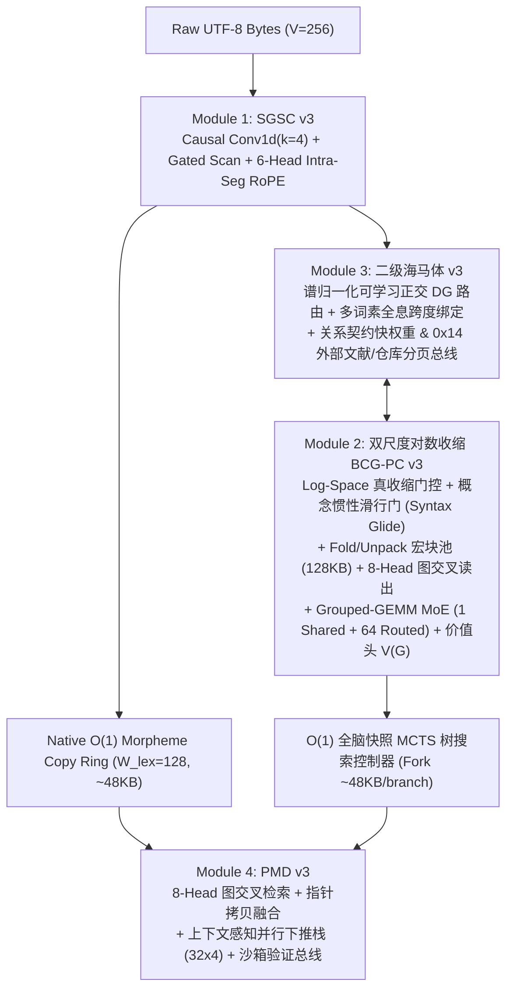

# DCPA 演进路线图（v1 → v2 → v3）：全科分步认知发育与下一代算子蓝图

> **文档定位**：本文件确立 DCPA（Developmental Concept-Predictive Architecture）完整三代演进坐标。核心战略调整为：**将原本跨度过大、耦合度过高的重型算子扩参方案后移至 v3，而将 DCPA v2 直接重构为基于 `moe_210m`（单卡主力、多卡弹性兼容）的「逻辑思维 35% + 深度写作 35% + 编程工程 30%」五阶段全科分步认知发育体系**——在不改动现行双栈核心算子与 `dcpa-core-rs` 本地引擎的前提下，率先把“像人类一样分步学习”的认知课程与数据炼金跑通。

---

## 0. 三代演进坐标与核心设计哲学

| 代际与状态 | 版本代号与主力模型 | 慢权重 / 单步激活 | 核心状态与记忆配置 | 核心使命（单代只攻坚一个主变量） |
| :--- | :--- | :--- | :--- | :--- |
| **第一代（当前在训）** | **DCPA v1 / v1.1** `proto_48m`（8 专家 Top-2） | `47.6M` / `~14M` | `K = 8` 概念图（`17.5 KB`）+ `7.52 MB` 海马体快权重 + `~22 KB` `BrainSnapshot` | **物理与双栈闭环验证**：跑完当前 `100k` 步，验证 `V=256` 字节流、Watchdog 自愈、`1↔N` GPU 弹性断点续跑及 Python/Rust 双端对齐 |
| **第二代（当前主攻）** | **DCPA v2（全科认知发育版）** **`moe_210m`**（32 专家 Top-2） *单卡主力 / 多卡弹性加速* | **`208.7M` / `~22.9M`** | 同上（100% 兼容 `dcpa-core-rs`）+ **Stage 5.5 零初始化外挂 `48 KB` 词素精确拷贝环（`W_lex = 128`）** | **认知课程与数据炼金突破**：落地五阶段「逻辑 35% + 写作 35% + 代码（Python/JS/SQL）30%」分步发育、三大数据炼金术、正交 `6×5` 语域文风开关与多稿自审/沙箱闭环 |
| **第三代（远期储备）** | **DCPA v3（底层算子重构版）** `moe_650m` – `moe_2_6b` （`1 Shared + 64 Routed`） | `0.65B–2.66B` / `~63M–198M` | 对数收缩图 SSM（`K = 8..10`）+ `128 KB` 宏块解包池 + 原生拷贝环 + 二级海马体分页 | **数学算子与规模放大**：在 **v2 已验证固化的黄金认知语料包（`.tar.zst`）** 上，重构七大底层结构算子、价值头 `V(G)` 与全脑快照 MCTS 树搜索 |

### 核心设计哲学（绝不走偏的三条铁律）
1. **三域脑区完全同构，绝不搞“一锅炖”统计硬背**：逻辑推演（命题因果有向边）、深度写作（`Slot-0` 立意统领与段落起承转合）与编程工程（边界守卫、Best Practice 与状态不变量）在 `BCG-PC` 的 `K = 8` 有向概念图上是同一套神经符号运算。慢权重专注内化**语法本能、通用推理算子、修辞审美与工程 Best Practice**；临时公理、人物设定集（World-Bible）与陌生业务 API 一律走海马体快权重。
2. **正视固定状态模型物理短板，以恒定微小缓存定向补齐**：纯 `K = 8` 概念归并天然存在**字面精确拷贝有损（Exact Token Copying Bottleneck）**。v2 在后训练阶段通过零初始化外挂 **`48 KB` 词素精确拷贝环（`R_lex`）** 负责抄准变量名、专有术语与长数字，把海马体彻底解放出来记忆**人物关系、临时规则与业务接口契约**，严守 `O(1)` 内存红线。
3. **把“零 KV Cache”转化为单卡训练与推理期搜索的降维优势**：`moe_210m` 慢权重扩至 `48M` 的 **4.4 倍**（32 专家足够分科），但单步激活仅 `~22.9M`，单张 24GB–80GB GPU 即可高效跑完全周期；推理期单分支活跃状态仅 **`~22 KB`**，微秒级 `fork` 数十个平行推演快照不到 `2 MB` CPU L3 缓存。

---

## 1. 已完成里程碑归档（DCPA v1 / `proto_48m` 双栈底座）

以下基础设施已在当前仓库验证落地，`48M` 正基于该底座完成 `100k` 步基线训练，`v2 (moe_210m)` 将 **100% 直接继承**：
1. **训练稳定性与数值安全红线**：
   * **唤醒 Pondering MoE 容量**：`tau_skip = 0.32`、`tau_halt = 0.22`、`lambda_act = 0.01`，配合 SM80+ `F.grouped_mm` 零同步稀疏分派（32 专家减少 16 倍无效专家计算）。
   * **谱安全 `0.5` 循环阻尼与归并器 `detach`**：在 v1/v2 的 `RMSNorm + Gumbel-STE` 结构下保持 `_DampedBoundedCarry(0.5, 0.25)` 与 `s_tilde.detach()`，彻底杜绝长序列雅可比爆炸饿死 `W_gen`（无损长程梯度留待 v3 对数收缩门解决）。
   * **尾部对齐 `Broca CQ`** 与 **单卡 ↔ 多卡无缝弹性续跑（`scripts/train.sh` + `configs/v1/dcpa_unified.yaml`）**：支持 `--gpus=1` 与 `--gpus=N` 共享同一套 Checkpoint 无缝切换，内置 `phys_offset` 单调游标与双向 `sqrt` 学习率自动缩放。
2. **本地 Rust 推理与睡眠巩固运行时（`dcpa-core-rs` + `dcpa-sleep-daemon`）**：
   * Python 与纯静态 `no_std` Rust 双端统一采用 Mode-1 闭环流式生成，原生支持 `\x1dS...\x1dE` 草稿帧、`Slot-0 Thesis Pinning`、`128B` 多帧下推栈自动清零、4-Row SIMD `BF16` 微内核以及 `0` 堆分配 `BrainSnapshot` 快照捕获/恢复。

---

## 2. 当前主攻路线：DCPA v2（`moe_210m` 单卡全科分步认知发育体系）

### 2.1 单卡算力标尺与模型容量规格（`moe_210m`）

`moe_210m`（`d_s=192, d_concept=768, K=8, d_r=32, num_experts=32, top_k=2, expert_hidden=1344, l_max=8, d_h=4096`）总慢权重 `208.65M`（`BF16` 模型 + `FP32` 优化器状态仅占 **`~3.4 GB` 显存**），单卡即可吃满算力，同时保留随时切多卡冲刺的弹性：

| 硬件档位 | 启动参数（`scripts/train.sh`） | 微批次 × 梯度累积 | 全局步预算（预训练 + Stage 5） | 预训练总字节流 / 去重语料库体积 | 预计单轮全周期耗时 |
| :--- | :--- | :--- | :--- | :--- | :--- |
| **单卡主力 A** `1× H100 / A100 80G` | `--gpus=1 --preset=moe_210m` | `128 KB × 1` （峰值显存 `< 36 GB`，零重算开销） | `100,000 + 15,000` 步 | `13.1 GB` 流 （建库 **`~5.2 GB`**，约 `2.5` epochs） | **~20 – 32 小时** |
| **单卡主力 B** `1× RTX 4090 / L4 24G` 或 `A100 40G` | `--gpus=1 --preset=moe_210m` | `32 KB × 4`（24G） `64 KB × 2`（40G） | `100,000 + 15,000` 步 | 同上（建库 **`~5.2 GB`**，数学轨迹与 80G 卡完全等价） | **~2.2 – 3.2 天**（4090） **~1.6 天**（A100 40G） |
| *多卡弹性冲刺（可选）* *`2×` 或 `4× A100`* | *`--gpus=4 --preset=moe_210m`* | *`128 KB/GPU × 4 = 512 KB/step`* | *`75,000 + 10,000` 步* | *`~38 GB` 流（建库 `~15 GB`）* | ***~9 – 13 小时*** |

---

### 2.2 五阶段发育总控与三域动态配比固化表（全局严格收敛 `35% : 35% : 30%`）

模拟人类**「先练字词语法本能 → 再搭论证与篇章/代码骨架 → 再结合审美与 Best Practice 慢思考重构 → 再学现场绑定陌生设定/接口 → 最后做多稿打磨与沙箱实战」**的真实学习路径：

* **动态配比守恒**：Stage 1 向纯净文学语感倾斜（`45%` 写作，校准中英 UTF-8 脉冲率 `ρ ≈ 9.5x`），Stage 2 向逻辑边与模块化代码倾斜（`37%` 逻辑 + `32%` 代码，塑造 `72` 对归并器），Stage 3–5 保持 `35:35:30`。**在 `0–100k` 预训练与 `0–115k` 全周期两个尺度上，步数加权积分均精确等于 `35.0% 逻辑 : 35.0% 写作 : 30.0% 代码`**。
* **`Slot-0` 渐进开启保护律**：一旦 `Slot-0` 锁定，`pin_mask_72` 会屏蔽涉及槽位 0 的 16 个归并对。因此 **Stage 2 前 20k 步严禁锁 `Slot-0`**（仅后 10k 步以 `15%` 预热），确保全部 72 个归并对先在自然段落与 AST 上充分受训，Stage 3 再拉升至 `45%`。

| 阶段与单卡步数区间 | 激活训练器官（硬冻结其余） | 窗口上限 `max_doc_bytes` | `\x1dS...\x1dE` 锁 `Slot-0` 比例 | 逻辑思维配比 | 深度写作配比 | 编程工程配比 | 核心认知发育目标 |
| :--- | :--- | :---: | :---: | :---: | :---: | :---: | :--- |
| **Stage 1：语感、韵律与语法肌肉期** `0 – 12k` | `SGSC + PMD` （绕过 `BCG-PC` 与海马体） | `512 B` | `0%` | **30%** | **45%** | **25%** | 训稳 `ρ ≈ 9.5x` 零乱码切分、中英引号破折号嵌套、Python/JS 括号栈 `Xi_t` 闭合与基础词法肌肉记忆 |
| **Stage 2：论证骨架与篇章/AST 期** `12k – 42k` | `SGSC + BCG-PC + PMD` | `512 → 1024 → 2048 B` | `0% → 15%` *(仅 32k–42k 预热)* | **37%** | **31%** | **32%** | 塑造 `K=8` 前提→结论有向边、`72` 对句法归并、文章段落起承转合与干净模块化代码结构 |
| **Stage 3：慢思考思辨与重构爆发期** `42k – 78k` | `SGSC + BCG-PC(32MoE) + Broca CQ + PMD` | `4096 B` | **45%** *(显隐混合 iCoT)* | **35%** | **35%** | **30%** | 分化 32 专家：逻辑谬误识别、逆向提纲统领长文、去 AI 腔病文改好文、Python/JS 反模式→Best Practice 重构 |
| **Stage 4：设定集与陌生契约绑定期** `78k – 100k` | **解冻**：海马体门控 + 适配器 **冻结**：`SGSC / BCG-PC / PMD` | `2048 → 4096 B` *(扩容 `W_max=64`)* | **40%** *(55% 新绑定 + 45% 回放)* | **35%** | **35%** | **30%** | 单次扫描锁死临时公理、长篇人物设定集（World-Bible）与私有 Python/JS SDK 契约，零吃书零串名 |
| **Stage 5 / 5.5：多稿打磨与外挂精修期** `100k – 115k` | **解冻**：`BCG-PC + PMD + 外挂 R_lex` **冻结**：`SGSC` + 海马体写门 | `4096 B` | **60%** *(复杂任务强制立意)* | **35%** | **35%** | **30%** | 挂载零初始化 `48 KB` 精确拷贝环；走通审题→初稿→自审精修、认知边界拒答与真实仓库排错闭环 |
| **全周期步数加权总计** | — | — | — | **35.0%** | **35.0%** | **30.0%** | **逻辑（因果边）× 写作（统领与张力）× 代码（精确与规范）同构收敛** |

---

### 2.3 五阶段开源数据集精确寻址与子配额固化清单（聚焦 EN/ZH + Python/JS/SQL，零 Rust 负担）

> **选材总则**：彻底砍掉训练语料中的 Rust 源码，将 32 专家中的工程容量 100% 集中于 **Python + JavaScript/TypeScript + SQL/JSON**；所有代码强制过 `tree-sitter` 零错与括号深度 `1..16` 校验；小体量精品集（`FOLIO`、`Crownelius/*`、`logical-fallacy`）固化 **`<= 3 epochs` 采样上限**防背题。

#### Stage 1（`0 – 12k` 步，窗口 `64–512 B`，强制从句首/函数首完整切片）
| 维度（阶段占比） | 固化数据源（Hugging Face Repo ID / 来源） | 阶段内子配额 | 选材与字节清洗规范 |
| :--- | :--- | :---: | :--- |
| **逻辑与科普（30%）** | • `HuggingFaceFW/fineweb-edu` (`sample-10BT`, `int_score >= 4`) • `opencsg/Fineweb-Edu-Chinese-V2.1` (`4_5/*.parquet`) | `15%` `15%` | 仅取定义清晰、因果/条件连词规范的完整独立自然段（`120–512 B`），严禁半腰截断 |
| **语感与文学（45%）** | • `HuggingFaceFW/finephrase`（经提纯改写的零语病结构化短篇） • `storytracer/US-PD-Books`（公版非虚构与文学精校自然段） • `opencsg/Fineweb-Edu-Chinese-V3`（出版物分包）+ 中文现当代名家散文精校短段 | `15%` `12%` `18%` | 重点保留成语典故、破折号与多层引号嵌套样本，夯实 `SGSC` 脉冲边界与 `PMD` 标点栈 |
| **纯净基础代码（25%）** | • `HuggingFaceTB/smollm-corpus` (`python-edu` 高分子集) + Python `cpython/Lib` 纯标准库短函数 • `TinyPixel/tiny-codes` 精选纯净 ES6+ JavaScript 短函数与合法 JSON/SQL 基础语句 | `14%` `11%` | 剔除第三方重框架与复杂异步业务逻辑，仅留 `<= 512 B` 语法覆盖完备的最小可运行单元 |

#### Stage 2（`12k – 42k` 步，窗口 `512 → 1024 → 2048 B`）
| 维度（阶段占比） | 固化数据源（Hugging Face Repo ID / 来源） | 阶段内子配额 | 选材与字节清洗规范 |
| :--- | :--- | :---: | :--- |
| **论证骨架（37%）** | • `tasksource/folio`（`yale-nlp/FOLIO` 免审批版，`<= 3 epochs`）+ `tasksource/proofwriter` + 双语一阶逻辑状态机合成器 • `lucasmccabe/logiqa`（中英行测逻辑）+ `metaeval/reclor`（复杂论证阅读） • `HuggingFaceTB/finemath` (`finemath-4plus` 文字证明与推导段落) | `12%` `13%` `12%` | 将前提与结论排成连贯推导段，直接驱动 `BCG-PC` 学习实体槽位绑定与蕴含/互斥有向边 `A_{ij}` |
| **篇章与修辞（31%）** | • `HuggingFaceTB/cosmopedia-v2`（历史、哲学、修辞学与社会科学教材章节） • `BAAI/CCI3-HQ`（头部商业评论、学术导论、人物传记；无审批 Token 时自动回退 `Fineweb-Edu-Chinese-V2.1` 5 分长文） | `14%` `17%` | 保留 `800–2048 B` 完整跨段论述（立论 → 论据展开 → 转折过渡），禁止切碎单句 |
| **模块化代码（32%）** | • `tokyotech-llm/swallow-code-v2`（经 SGCR/SCOR 风格与自包含优化重写的高分 Python 模块） • 模块化现代 JS/TS 工具库切片 + 带表结构约束的规范 SQL 查询对（`b-mc2/sql-create-context` 精洗） | `18%` `14%` | 保留顶部 Docstring/JSDoc 设计契约与下方实现的完整对应，训练按作用域归并 |

#### Stage 3（`42k – 78k` 步，窗口 `4096 B`）
| 维度（阶段占比） | 固化数据源（Hugging Face Repo ID / 来源） | 阶段内子配额 | 选材与字节清洗规范 |
| :--- | :--- | :---: | :--- |
| **慢思考与谬误（35%）** | • `PleIAs/SYNTH`（原生含 `→` 推导、`↺` 回溯、`∴` 结论与置信度 `●/◐/○` 的高密度推理链） • `facebook/natural_reasoning`（跨经济、社科、人文与理工因果问答，离线蒸馏 `< 240 B` 符号链入 `\x1dS`） • `m-a-p/COIG-CQIA`（`zhihu` 深度思辨高赞长答 + `ruozhiba` 语义逻辑陷阱） • `causalNLP/logical-fallacy` + 双语 13 类逻辑谬误诊断合成集（`<= 3 epochs`） | `11%` `10%` `10%` `4%` | 彻底剥离千字口语 `<think>` 废话！统一压缩进 `<= 240 B` `\x1dS...\x1dE` 草稿帧锁定 `Slot-0` 后再输出论述 |
| **名篇提纲与改稿（35%）** | • **逆向提纲名篇库**（从顶级中英评论、研报与经典散文反推 `150–240 B` 立意蓝图前置入 `\x1dS...\x1dE`） • `Crownelius/Creative-Writing-High-Quality-1300x` + `Crownelius/Novel-Crafting-250x`（Shadow & Skeleton 叙事骨架，`<= 3 epochs`）+ 中文高审美叙事精选 • **「去 AI 腔」病文重构对**（离线向名家好文注入套话/因果倒置生成粗糙初稿置于 `mask=0`，`\x1dS` 病因诊断 + 原版精炼定稿置于 `mask=1`） | `14%` `10%` `11%` | 根治“总而言之/值得注意的是/delve/tapestry”塑料文风；训练稀疏 MoE 成为删繁就简的“文字总编” |
| **算法与 Best Practice（30%）** | • `nvidia/OpenCodeReasoning-2`（提取 Python 算法 `guard \| bp \| complex \| flow` 紧凑骨架入 `\x1dS`）+ `cruxeval-org/cruxeval` 状态追踪 • `bigcode/commitpackft`（Python/JS/SQL 缺陷根因修复）+ **反模式→Best Practice 重构对比库**（`Bad Code [mask=0] -> \x1dS smell+fix \x1dE -> Idiomatic Code [mask=1]`） | `15%` `15%` | 重点覆盖 Python 可变默认参数/`O(N^2)` 查找/裸 `except`、JS 隐式相等/未处理异常/异步竞态、SQL 注入与索引友好写法 |

#### Stage 4（`78k – 100k` 步，窗口 `2048 → 4096 B`）：`55%` 新绑定 + `45%` 熟语抗误写回放
| 维度（阶段占比） | 固化数据源与海马体快权重训练管线 | 阶段内子配额 | 快权重绑定与掩码规范 |
| :--- | :--- | :---: | :--- |
| **临时公理与合同（35%）** | • 反直觉虚构桌游规则 / 临时运算公理 / 陌生合规合同条款审阅合成器 + Stage 3 熟语逻辑回放 | `19%` 新绑定 + `16%` 回放 | 顶置临时规则区 `mask = 0` 单次扫入快权重；判决区 `mask = 1`，强制抑制慢皮层常识干扰 |
| **设定集与材料写作（35%）** | • **World-Bible 长篇设定集续写**（全新人物关系、性格禁忌、器物伏笔）+ **陌生行业调研纪要 → 研报撰写** + 熟语写作回放 | `19%` 新绑定 + `16%` 回放 | 跨越 `1500–3000 B` 校验专有名字、伏笔细节与调研数字（锚点字节 `3.0x` 权重），零吃书零串行 |
| **私有业务 SDK 契约（30%）** | • **多接口合成 Python/JS 业务微 SDK（Code-Wug v2）**（随机数据结构 + 3–4 个带状态先后依赖的 OOV 接口 + 干扰接口 + 双轮规则变更覆写）+ 熟语代码回放 | `17%` 新绑定 + `13%` 回放 | 验证陌生接口签名记忆、前置调用顺序守恒，以及 Turn 2 规则修改时的 Householder 擦写更新 |

#### Stage 5 & 5.5（`100k – 115k` 步，窗口 `4096 B`）：外挂拷贝环、多稿打磨与沙箱实战
| 维度（阶段占比） | 固化数据源与闭环管线 | 阶段内子配额 | 后训练与交互行为规范 |
| :--- | :--- | :---: | :--- |
| **苏格拉底思辨与边界（35%）** | • 多轮前提缺失追问、反方辩驳与认知边界诚实拒答集（对齐 `SYNTH` 不确定性标记） • `teknium/OpenHermes-2.5` + `COIG-CQIA` 中英高分逻辑拆解与多约束指令（`cap_instruct`） | `20%` `15%` | 绝不闭卷编造未知百科或私有数据；主动请求用户用一句话投喂事实入快权重或发射 `0x11` 调工具 |
| **作家式多稿打磨（35%）** | • **三步作家改稿闭环轨迹**（`Turn 1: 审题 + \x1dS 立意提纲 -> 初稿`；`Turn 2: 审校指出套话/节奏问题 -> \x1dS 修订方案 -> 精修定稿`） • `Crownelius/Creative-Writing-Multiturn_Enhanced`（中英双语脱敏精洗） | `23%` `12%` | 固化自我审校改稿能力，严格检验同一命题在 5 档 `style_id` 下文风零串味 |
| **真实仓库与工具闭环（30%）** | • `SWE-bench/SWE-smith-py`（单文件 `<= 3072 B` 缺陷定位与补丁生成轨迹）+ Python↔JS 跨语言重构 • `0x11/0x13/0x12` 本地安全 AST 沙箱工具链调用、报错自愈与 OOV 参数精确传递集 | `18%` `12%` | 前 `2,000` 步先单独预热零初始化 `R_lex` 拷贝旁路，后 `13,000` 步联训 `BCG-PC + PMD + R_lex`（可选再接 `2k` 步轻量沙箱 GRPO） |

---

### 2.4 `PMD` `6 × 5` 正交语域与文风控制坐标固化表（100% 兼容现有编号）

直接复用现有 `d_l = 64`（`32D lang_embed ⊕ 32D style_embed`），**完全保留现有代码已使用的 `0=en, 1=zh, 3=python, 5=javascript` 及 `style_id 1..4` 编号**，同时将闲置的 `lang_id=2, 4` 与 `style_id=0` 赋予高价值正交语义，彻底隔离“代码说明书味”与“文学张力”：

| ID | `lang_id`（模态与语法域，控制词法与括号栈 `Xi_t`） | `style_id`（表达与审美域，控制节奏、修辞与信息密度） | 典型正交组合坐标示例 `(lang_id, style_id)` |
| :---: | :--- | :--- | :--- |
| **`0`** | **`en`**：英文自然语言 *(对齐现网)* | **`rigorous`**：严谨思辨、学术导论与深度政论（高因果密度） | • `(1, 0)`：中文深度商业评论 / 硬核思辨长答 • `(0, 3)`：英文文学叙事 / 具象白描短篇 |
| **`1`** | **`zh`**：中文自然语言 *(对齐现网)* | **`concise_memo`**：极简符号草稿、金字塔备忘与研报摘要 *(对齐 `memo`)* | • `(1, 3)`：中文名家散文风 / 长篇设定集小说续写 • `(0, 1)`：麦肯锡式英文决策备忘录 |
| **`2`** | **`formal`**：形式化逻辑、数学证明与纯符号演算 *(激活原闲置槽 2)* | **`expository`**：教学科普、循序引导与清晰阐释 *(对齐 `expository`)* | • `(2, 0)`：一阶逻辑推演 / 数学引理证明 • `(1, 2)`：苏格拉底式中文科普拆解 |
| **`3`** | **`python`**：Python 算法、工程与数据科学 *(对齐现网)* | **`literary`**：文学叙事、散文随笔与意象留白 *(对齐 `narrative`)* | • `(3, 4)`：零坏味道生产级 Python 实现 + AST 沙箱 • `(3, 2)`：带教学推导的算法详解 |
| **`4`** | **`sql_struct`**：SQL 查询、JSON Schema 与结构化协议 *(激活原闲置槽 4)* | **`strict_eng`**：生产级工程规范、API 契约与工具协议 *(对齐 `strict_code_tool`)* | • `(5, 4)`：现代模块化 JS/TS 工程实现 • `(4, 4)`：严格 Schema 约束的 SQL / JSON 提取 |
| **`5`** | **`javascript`**：JavaScript / TypeScript 现代工程代码 *(对齐现网)* | — *(共 5 档：`0..4`)* | — |

---

### 2.5 入库三大「数据炼金」封装规范与 v2 最小代码升级清单

#### A. 三大高杠杆数据炼金模板（100% 兼容 `utils/chat_protocol.py`）
1. **逆向提纲 + `Slot-0` 统领**（`\x1dS` 严格限制在 `120–240 B`，全段 `mask = 1`）：
   * **议论/研报**：`\x1fA\n\x1dS\n立意:... | 质疑:... | 递进:A->B->C | 落点:...\x1dE\n{正文}\x04\n`
   * **叙事/小说**：`\x1fA\n\x1dS\n动机:... | 冲突:... | 伏笔物:... | 转折:...\x1dE\n{正文}\x04\n`
   * **算法/工程**：`\x1fA\n\x1dS\nguard:... | bp:... | flow:A->B->C\x1dE\n{代码}\x04\n`
2. **病文 / 坏味道代码重构对**（反面输入严格置 `mask = 0`，绝不让 `PMD` 学习生成烂文或烂代码）：
   * `\x1eU\n{指令 + 稀释病文或坏味道代码}\n\x1fA\n\x1dS\n诊断:{套话/因果倒置/O(n^2)隐患} -> 修正策略\x1dE\n{精炼定稿或地道代码}\x04\n`
3. **设定集 / 临时公理 / 私有 SDK 顶置快权重扫入**（顶置区与提问区 `mask = 0`，回答区 `mask = 1`，关键实体/接口命中字节 `3.0x` 权重）：
   * `{顶置 World-Bible 人物表 / 临时公理 / OOV SDK 签名}\n\x1eU\n{任务}\n\x1fA\n\x1dS\n召回锚点:...\x1dE\n{输出}\x04\n`

#### B. 跑通 DCPA v2（`moe_210m`）仅需实施的 4 项轻量非破坏性改造
1. **解除 Stage 1–3 单池混抽与半腰截断**（`train/train_dcpa.py` + `data/ragged_dataloader.py`）：利用 `.idx` 的 `source_id` 标记阶段难度层级（`Stage 1` 仅抽 `tier=1` 且强制 `w_start=0` 从段首切片，杜绝半截代码污染 `SGSC+PMD`）。
2. **修复海马体训练缓冲与 Stage 5 写门阈值**（`configs/` + `train/train_stage5_sft.py`）：Stage 4 窗口扩至 `2048–4096 B`、`householder_max_writes: 32 -> 64`，并在 Stage 5 显式传入 `write_threshold_override=0.08`，消除长对话下 `CompactHouseholderState` FIFO 挤出顶置设定的训推失配。
3. **Stage 5.5 零初始化外挂 `48 KB` 词素精确拷贝环（`R_lex`）**：维护 `W_lex = 128`（过滤纯空白词素后有效跨度 `> 1800 B`）的 `f_stem` 环形缓存，以 `< 0.3M` 参数、全零初始化输出投影 `W_copy_out = 0` 叠加至 `PMD` `f_out`，无损继承 `100k` 底座并根治 OOV 变量名/专有名词抄写失真。
4. **扩展 `prepare_vast_corpus.py` 新增 `v2_cognitive_5g` 单卡精炼档**：并发构建上述五阶段分片并支持一键打包 `.tar.zst`。

---

### 2.6 DCPA v2 新增全科验收门禁（Gates 7 – 10）

在现有 `gates/gate1..gate6` 全部绿灯基础上，新增四道全科能力硬门禁：
* **Gate 7（逻辑谬误诊断与临时公理服从门禁）**：在 13 类逻辑谬误测试集与反常识虚构规则集上，谬误定位与严格按临时公理推演准确率 `>= 90%`（零慢皮层常识抢答）。
* **Gate 8（`3000 B` 长文 `Slot-0` 统领、零吃书与反塑料文风门禁）**：给定全新 World-Bible 人物禁忌与逆向提纲撰写 `3000 B` 文章/章节，人物设定召回准确率 `>= 95%`，AI 套话黑名单命中率 `== 0.0%`，5 档 `style_id` 盲测区分度显著。
* **Gate 9（陌生 Python/JS SDK 零抄错与 Best Practice 门禁）**：给定未见过的多接口业务微 SDK 与边界陷阱题，`tree-sitter` 语法合法率 `>= 99.5%`，OOV 接口拼写与调用顺序准确率 `>= 98%`，AST 反模式静态检查（零可变默认参数、零裸 `except` 等）通过率 `>= 98%`。
* **Gate 10（`22 KB` 快照两段式搜索与认知边界门禁）**：验证先并行 `fork` 4 个 `\x1dS...\x1dE` 立意/骨架快照再展开正文或代码的端到端增益；面对超纲私有事实提问，诚实拒答或主动请求快权重教学触发率 `>= 95%`。

---

## 3. 远期算子演进储备：DCPA v3（`moe_650m – moe_2_6b` 七大底层重构）

当 **DCPA v2（`moe_210m`）** 完成全科分步课程验证并将 `.tar.zst` 黄金数据资产包彻底固化后，DCPA v3 将在**保持数据变量恒定**的前提下，突破 v1/v2 固定架构的物理天花板（需同步升级 v3 `dcpa-core-rs` 张量格式）：

1. **对数空间真收缩图 SSM + 语法惯性滑行门 + `8-Head` 图交叉读出 + `Fold/Unpack` 宏块池（BCG-PC v3）**：
   * 移除人工 `_DampedBoundedCarry`，引入前向/反向完全一致的对数空间衰减门 $\Lambda_m \in [0.97, 0.999]$；
   * 增加**语法惯性滑行门（Syntax Glide Gate）**：在低惊奇语法胶水区挂起 `K+1 -> K` 槽位归并与显著性衰减，让 1 个高层概念意图自然驱动 `PMD` 滑行展开整段代码/句式，将 `K=8..10` 槽位的有效逻辑跨度放大 3–5 倍；
   * 以 **8 头图交叉注意力读出** 替代单向量 `g_ctx` 均值瓶颈，并配 `128 KB` 会话宏块池支持高惊奇子命题按需 `Unpack` 回查。
2. **上下文感知感官核与抗干扰 `O(log T)` 并行下推栈（SGSC v3 & PMD v3）**：
   * `SGSC` 前置轻量 `CausalConv1d(k=4)` 与 6 头段内 RoPE 抽取；
   * `PMD` 栈动作门升级为依赖 `Conv1d_k4(u_{t-3:t}) + d_drive + l_reg`（不依赖循环态 $m_{t-1}$，100% 保留 `O(log T)` `parallel_stack_scan` 并行训练速度），原生学会在代码字符串字面量与注释中自动挂起 `p_hold = 1.0`，栈深扩至 `32 × 4`。
3. **谱归一化可学习正交海马体路由、关系契约绑定与 `0x14` 二级分页总线（Hippocampus v3）**：
   * 引入可学习对比白化齿状回键与多词素全息跨度绑定，拉开近似变量名/人名的正交距离；支持存储 `(前置状态, 关系边) -> 后置契约`，并增设 `0x14` 外部仓库/文献按需分页帧。
4. **`1 Shared + 64 Routed` 无辅助损失均衡 MoE + 原生价值头 `V(G)` + 量化多核 Rust 引擎**：
   * 常驻共享专家专门沉淀跨领域基础语法、修辞底色与工程 Best Practice，路由专家专精细分推理算子；挂载价值头 `V(G)` 驱动 `~48 KB` 快照 MCTS 搜索；`dcpa-core-rs` 升级 `Q8_0 / Q4_K` 慢权重 + 多核专家并行调度，实现笔记本 CPU 零 GPU 高速推演。
5. **原生情节记忆查找层（`Episodic Memory Lookup Layer`，O(1) 显存 + 无限精确上下文） `[TODO / v3 核心演进]`**：
   * **动机与局限**：v2 架构的 L1 共享环（`W=128` 概念 ≈ 1.2 KB）负责近距精确拷贝、L2 `K=8` 概念图负责有损语义压缩、L3 海马体快权重（`max_writes=64`）负责高 ACh 显著新实体绑定；对于超长文档中**滑出 1.2 KB 且编码当下未触发高 ACh 的无预兆随机细节（大海捞针 / 远距精确拷贝）**，固定压缩态存在物理容量上限。
   * **类脑机制（Hippocampal Indexing + 主动翻书）**：
     * **0 显存外部情节索引库（Host RAM / NVMe）**：流式读取长文时，直接复用 `SGSC` 已切分的概念段，将 `(c_slow 压缩语义键, 轻量字面倒排/哈希键 -> 原文偏移 offset / c_kv 切片)` 异步写入主机内存或 NVMe 索引表（100 MB 原文仅占数十 MB RAM，**GPU 显存严格保持 O(1)**）。
     * **`Surprisal` 门控自动触发检索**：解码/推演过程中，当模型内生 `surprisal`（预测不确定性）超过可学习门控阈值时，自动用当前概念查询向量 + 词素线索向外部索引发起 `< 1 ms` Top-K 快速查找。
     * **直写 `ring_kv` 复用现有精确拷贝通路**：将召回的 Top-K 原文片段 `c_kv`（附带 retrieved 标记/坐标）直接写入或拼接至 `CorticalSandwich` 的 `ring_kv` 查找槽位，由现有 Upper Cortical Decoder + `w_copy_out` 指针拷贝通路原样精确输出，实现 **O(1) GPU 显存 + 无限精确上下文**。
   * **分阶段 TODO 落地路线**：
     * [ ] **Phase A（v2 零重训过渡）**：复用现有 Stage 5 `cap_toolcall`，在推理侧 / `dcpa-core-rs` 挂接亚毫秒级本地内存 `lookup(query)` 检索工具，先行解锁超长文档大海捞针精确查找。
     * [ ] **Phase B（v3 原生模块）**：在 `dcpa/modules/` 新增可学习门控 `EpisodicMemoryLookup` 层，支持训练期模拟外部索引检索 + `surprisal` 触发门控稀疏正则，以及推理期直写 `ring_kv` 零 KV Cache 膨胀。
     * [ ] **Phase C（验收门禁 Gate 11）**：新增 **Gate 11（超长文档大海捞针与远距精确拷贝门禁）**——在 `100 KB – 1 MB` 无预兆随机针 / 跨文件代码引用测试集上，以 O(1) GPU 显存达到 `>= 98%` 逐字节精确召回率。

---

### 3.1 DCPA v3 全龄螺旋发展课程体系（K-12 → 大学 CS → 工程实战）`[TODO]`

> **核心理念**：模仿人类从幼童启蒙到大学专精的认知发育规律——先打牢**文字语言、基础数学与逻辑骨架**，再拓展**物理/化学/生物**等自然科学世界模型，继而进阶**大学离散数学、数据结构与算法理论**，最后才切入**工程级代码实现**；让模型写代码时用的是前面建立的逻辑与算法思维，而非死记语法模板。

#### 三大工程防呆铁律
1. **螺旋滚雪球防遗忘（Cumulative Replay）**：严禁“学完新学科就丢掉旧学科”。每个进阶阶段采用 **50–60% 新学科主力 + 40–50% 前序全科回放**，防止灾难性遗忘（Catastrophic Forgetting）。
2. **感官层早期符号启蒙（5–10% Syntax Exposure）**：在 Phase 1 训练底层字节分段器（`SGSC + PMD`）阶段，保留 `5–10%` 极简数学符号与入门伪代码/干净语法样本，避免底层切词器将代码定界符（`{}()[]:;`）误判为噪声。
3. **容量与语料匹配**：配合 v3 `moe_650m`（6.5 亿参数 / 32–64 专家自然按学科分化）及 `20–30 GB+` 去重高质量教科书/百科/理化生/CS 理论/工程语料，满足 Chinchilla 缩放配比。

#### 六阶段全龄发育课程表

| 成长阶段 | 对应“学龄” | 主力学科语料（50–60%） | 累积复习回放（40–50%） | 对应大脑模块发育 |
| :--- | :--- | :--- | :--- | :--- |
| **Phase 1** | **小学启蒙** | 高质量中英阅读/故事、清晰句法、小学算术与基础常识、5–10% 极简符号/伪代码启蒙 | — | `SGSC + PMD`（感官认字、拼写与断句节律成型） |
| **Phase 2** | **初中思维** | 形式逻辑（因果/三段论/FOLIO/ProofWriter）、初中代数几何证明、清晰说明文写作 | Phase 1 语言与基础算术 | 解冻 `BCG-PC`（学会将句子压缩为因果概念图） |
| **Phase 3** | **高中理科** | **物理、化学、生物**教材、公式推导与实验因果机制（建立多变量自然世界模型） | Phase 1–2 语言与逻辑 | `BCG-PC` 窗口扩大，MoE 专家按学科初步分化 |
| **Phase 4** | **大学 CS 理论** | 高等数学（线代/概率/离散数学）、**数据结构与算法**（树/图/DP/复杂度分析）、系统原理 | Phase 1–3 语言/逻辑/理化生 | System-2 `Pondering` 与抽象建模能力成熟 |
| **Phase 5** | **工程实战** | Python / JS / SQL 工程代码、AST 规范、反模式重构、调试与长文多稿写作（45% 能力炼金） | Phase 1–4 全科防遗忘 | 解冻 `Broca CQ`（将算法与逻辑落地为工程代码） |
| **Phase 6** | **社会实践（在线学习）** | 海马体现场绑定新公理/新 SDK + v3 原生 `Episodic Memory Lookup` 翻书 + Stage 5 对话/工具 SFT | 反误写常规回放 | `Hippocampus + Episodic Lookup + Sleep Daemon`（终身学习体） |

#### Phase 1 – 6 实操数据源清单（Hugging Face / 开源教材仓）

| 阶段 | 英文主力数据源（开源可流式拉取） | 中文主力数据源 | 说明 |
| :--- | :--- | :--- | :--- |
| **Phase 1 小学启蒙** | `roneneldan/TinyStories`、`HuggingFaceTB/cosmopedia`（`stories`）、`storytracer/US-PD-Books`、`openai/gsm8k`、5% `HuggingFaceTB/smollm-corpus`（`python-edu` 短函数） | `adam89/TinyStoriesChinese`、`opencsg/Fineweb-Edu-Chinese-V2.1`（短篇清晰科普/散文筛选） | 立住双语句法与基础算术，5% 极简符号供 `SGSC` 启蒙 |
| **Phase 2 初中思维** | `tasksource/folio`、`ProofWriter`、`LogiQA`、`HuggingFaceTB/cosmopedia`（`khanacademy`）、`HuggingFaceTB/finemath`（`finemath-4plus`）、`cosmopedia-v2` | `opencsg/Fineweb-Edu-Chinese-V3`（高分说明文与初高中数学逻辑分拣） | 逻辑推理 + 数学证明 + 清晰说明文 |
| **Phase 3 高中理科** | `HuggingFaceTB/openstax_paragraphs`、`crumb/openstax-text`、`HuggingFaceTB/cosmopedia`（`openstax`）、`nvidia/Nemotron-Science-v1` / `Nemotron-SFT-Science-v2`、`HuggingFaceFW/fineweb-edu`（`int_score>=4` 理科筛出） | `opencsg/Fineweb-Edu-Chinese-V2.1/V3`（4–5 分桶按物理/化学/生物术语与公式密度分拣）+ 中文维基科学精选 | 真实 OpenStax 教材 + NVIDIA 科学机制推演 |
| **Phase 4 大学 CS 理论** | `nvidia/Nemotron-Pretraining-Specialized-v1.1`（`Code-Concepts`，含 `algorithms.*`/`data-structures.*` 精确标签）、`open-phi/programming_books_llama`、`SciPhi/textbooks-are-all-you-need-lite`、`nvidia/Nemotron-CC-Math-v1` | `Fineweb-Edu-Chinese-V3`（算法/数据结构/离散数学分拣）+ 浅克隆 MIT/CC 开源算法教材仓（如 `krahets/hello-algo`、`OI-wiki/OI-wiki`） | 先懂数据结构、算法复杂度与离散数学，再写工程代码 |
| **Phase 5 工程实战** | `tokyotech-llm/swallow-code-v2`、`b-mc2/sql-create-context` + CTE Schema、ES6+ 模块化 JS + 顶级开源工程仓、仓库自带 `data/build_cap_*.py` 520 MB 能力炼金 | 中文工程文档 + `build_cap_writing.py` 逆向提纲与反塑料文风炼金 | 完整复用现有 v2 AST 门控与能力炼金管线 |
| **Phase 6 在线学习 & SFT** | `data/wug_generator.py`（World-Bible / 临时公理 / 陌生 SDK）、`data/build_sft_stage5.py`、新增 `100 KB` 合成大海捞针翻书样本 | 同左（中英双语） | 激活海马体快权重 + v3 翻书查找 + 工具调用 |

#### TODO 实施拆解
* [ ] **语料采集与分级标签体系（`data/build_corpus_v3_k12.py`）**：在 `.idx` 的 `source_id` 中扩充 `phase_tier ∈ {1..5}` 与学科域标签（新增自然科学 `science: physics/chem/bio` 与计算机理论 `cs_theory: algo/ds/discrete_math` 语料源，优先筛选 OpenStax / FineWeb-Edu 教科书级高分样本）。
* [ ] **螺旋课程调度器（`train/curriculum_state_machine.py`）**：支持 `5–6` 阶段可配置边界与按阶段动态切换 `phase_tier` 滚雪球采样权重。
* [ ] **同台基线对照实验（Benchmark Gate）**：在 `moe_210m` / `moe_650m` 上分别对比「混训 vs K-12→大学螺旋课程」以及「DCPA vs 同算力标准 Transformer」的各科 Val BPC 与推理准确率。

---

### 3.2 可插拔专家生态（Pluggable MoE / Expert Plugin Architecture）`[TODO]`

> **愿景（“Expert App Store”）**：冻结 DCPA Base（慢皮层共享基座 + 原生 32 路由专家），允许任何社区开发者在消费级显卡/Mac 上仅用自有垂直领域数据训练 **1–4 个轻量化新专家插件（`*.dcpa_expert.safetensors`）** 并自由分享；终端用户下载 Base 后，可按需同时热挂载任意多个社区专家（如 Rust 专家 + 法律专家 + 金融专家 + 医学专家），**零重训即插即用，且因为 Top-K 稀疏激活，挂载数十个专家推理速度几乎零下降！**

#### 为什么 DCPA-Turbo 天生适合 Pluggable MoE？
* `Cortical`（`SharedAndRoutedMoE`）与 `BCG-PC`（`SparseMicroMoE`）的路由专家均为完全独立的 3D 切片（`w_gu[e]`, `w_d[e]`, `router.weight[e]`），且通用语言底色已沉淀在常驻 `Shared Expert` 中。
* **体积极度轻量化**：在 `moe_210m` 下，**1 个完整跨层专家插件仅约 `~5.9M` 参数**（BF16 仅 `~11.8 MB`，Q4 量化仅 `~3.5 MB`），单卡 T4 / L4 / Mac 几十分钟即可训完一个高质量垂直领域专家，文件体积极易分发且完全不泄露 Base 权重。

#### 必须解决的三大工程关键点
1. **防路由劫持（Cosine Router + 温度校准）**：
   * 不同开发者独立训练的插件 `router` 向量范数不同，直接拼接易导致某个插件抢占全部路由分数（Router Hijacking）。
   * **解法**：插件路由键统一采用 **L2 归一化 Cosine Similarity**（`cos(norm(x), norm(k_plugin)) * scale + bias`）并配阈值/边际约束，保证仅当输入语义真正命中该插件领域时才被选中，对非本领域输入保持零干扰。
2. **多插件无痛叠加（Zero-Init Plugin Gate + 隔离混合）**：
   * 为每个挂载插件配备独立的零初始化残差缩放门控 `alpha_plugin`（训练起始等价于纯 Base，100% 不破坏原能力），推理期支持 `Base Top-2 + Plugin Top-1` 残差融合或显式插件权重调节（如 `--plugin rust.safetensors:0.9 --plugin legal.safetensors:1.0`）。
3. **统一插件文件契约（`*.dcpa_expert.safetensors` + `plugin_manifest.json`）**：
   * 仅存储新增专家的 `(router_keys, w_gu, w_d, alpha_plugin)` 张量 + `base_arch_hash`（校验 `d_concept / expert_hidden / n_layers` 匹配性），支持 Python 引擎与 Rust `dcpa-core-rs` 启动时动态拼接加载（`E_total = E_base + sum(E_plugins)`）。

#### TODO 实施拆解
* [ ] **训练脚手架（`train/train_expert_plugin.py`）**：加载冻结 Base，按 `--num-plugin-experts K` 挂载可训练专家切片 + Cosine Router 键，支持在垂直领域数据上低成本单卡训练并导出纯插件 `.safetensors`（~12 MB/专家）。
* [ ] **热插拔推理挂载器（`dcpa/plugin_loader.py` + `dcpa-core-rs`）**：实现多插件校验、动态张量拼接、Cosine 路由隔离及按需启用/禁用开关。
* [ ] **零退化与多插件组合验收测试**：验证单插件垂直领域 BPC 显著下降、非目标领域 BPC 退化 `< 0.5%`、以及同时挂载 3 个不同领域插件无互相干扰。
