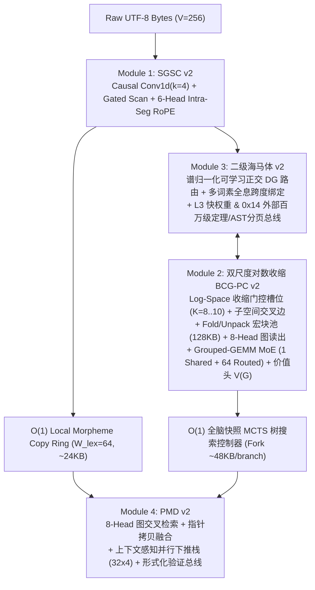

# DCPA 演进蓝图（v1.1 → v1.5 → v2）：对标现代本地小模型的独立架构评审与下一代路线图

> **文档定位**：本文件汇总 DCPA 对标现代本地小模型（`Qwen3-0.6B`、`SmolLM2-360M`、`Gemma-3-1B`、`RWKV-7`、`Gated DeltaNet`、Meta `BLT`）的独立架构审计结论，并按时间线明确划分为三档：**v1.1（已在 38k 热更新与本地 Rust 端落地）**、**v1.5（等当前 100k 训练完直接后训练，零重训底座）**、以及 **DCPA v2（下一代从零训练架构规范）**。

---

## 0. 认知坐标、时间线与演进总则

| 阶段与时间节点 | 版本代号 | 慢权重 / 单步激活 | 核心状态与记忆架构 | 关键升级内容 |
| :--- | :--- | :--- | :--- | :--- |
| **现在（已完成）** | **DCPA v1.1** （38k/39.5k 热更新 + 本地双栈就绪） | `48M` 原型 / `210M` MoE （激活 `~23M`） | `K = 8` 概念图（`17.5 KB`）+ `7.52 MB` 海马体快权重 + `~22 KB` `BrainSnapshot` | 唤醒 Pondering MoE（`0.32/0.22/0.01`）、保持谱安全 `0.5` 阻尼与 `s_tilde.detach()`、尾部对齐 `Broca CQ`、`[0, 15k, 65k, 94k, 100k]` 课程重排；Python/Rust 双端 Mode-1 闭环 + 4-Row SIMD + `BF16` MoE 权重加速 |
| **100k 跑完立刻做** （零重训主干） | **DCPA v1.5** （Stage 5.5 / Stage 6 后训练） | 复用 `dcpa_final.safetensors` + 零初始化外挂旁路（`< 0.5M`） | 同上 + **外挂 `24 KB` 词素精确拷贝环（`W_lex = 64`）** + 快照树搜索 | 渐进式 iCoT + 元认知工具卸载 + 草稿内反证回溯 + **零初始化残差 `f_stem` 指针拷贝头（根治变量名/常数抄错）** + Stage 6 轻量 GRPO + `Beam/MCTS` 推理树搜索 |
| **下一代从零训练** | **DCPA v2** （形式化推演内核） | **`1.8B–2.6B` Sparse MoE** （1 常驻 + 64 路由 `Top-2`，激活 `~200M`） | **对数收缩图 SSM（`K = 8..10`）+ `128 KB` 宏块解包池 + `24 KB` 词素拷贝环 + 二级海马体分页** | 7 大底层结构重构：真收缩门控图状态 + 8 头图交叉读出 + `Fold/Unpack` 子图解引用 + `Conv1d(k=4)` 6 头感官核与上下文感知并行下推栈 + 可学习谱归一化正交海马体路由 + 真稀疏 Grouped-GEMM MoE + 价值头 `V(G)` 与形式化 RLVR |

### 核心设计哲学（对标现代小模型绝不走偏的三条铁律）
1. **扬长避短，绝不跟稠密 Transformer 拼“闭卷背百科全书”**：在 `50M–300M` 激活规模下，DCPA 拥有 **`V = 256` 零 Tokenizer 免疫乱码**、**`O(1)` 恒定内存（零 KV Cache 膨胀）**、**单次扫描海马体测试期快权重记忆** 三大独门物理优势。慢权重专注学习**抽象逻辑律、启发式策略/价值直觉（Policy & Value Intuition）与检索/工具调度**，冷门事实与海量引理一律走海马体快权重与外部检索总线。
2. **正视并补齐固定状态模型的两大物理短板（Exact Copy & Long-Horizon Credit）**：相比保留全量历史 KV Cache 的 `Qwen3-0.6B` / `Gemma-3-1B`，纯 `K = 8` 概念压缩图天然存在**字面精确拷贝有损（Exact Token Copying Bottleneck）**与**有损归并不可逆**两大短板。v1.5 与 v2 通过极小恒定开销的 **`24 KB` 词素精确拷贝环** 与 **`128 KB` 宏块按需解包池** 定向补齐，严守 `O(1)` 复杂度红线。
3. **把“零 KV Cache”转化为推理期搜索的降维打击**：`7B` Transformer 并行展开 64 条长思维链需数十 GB KV 显存；DCPA 单分支活跃状态仅 **`22 KB`（v1）– `48 KB`（v2）**，微秒级 `fork` 64 个平行推演宇宙总共不到 **`3 MB`** CPU L3 缓存。

---

## 1. 已完成里程碑（DCPA v1.1）：38k 热更新与本地 Rust 引擎升级清单

以下改进已在当前仓库完成实施并通过双栈验证（Colab 远端已基于热更新代码从 `~38,000` 步无缝续跑）：
1. **训练侧热修复（无需重训前 39.5k 步）**：
   * **唤醒 89% 休眠 Pondering MoE 容量**：`tau_skip: 0.65 -> 0.32`、`tau_halt: 0.35 -> 0.22`、`lambda_act: 0.04 -> 0.01`，消除静态图下空算无梯度的浪费（实测 `39,500` 步 `Val_BPC` 降至 `2.1896`、`Skip% = 32.4%`、`GN = 1.35`）。
   * **保持谱安全 `0.5` 循环阻尼与归并器 `detach`（40k 实测教训归档）**：在非收缩 `RMSNorm + Gumbel-STE` 的 v1 结构上强行放开循环阻尼（`0.95/0.85`）与 `s_tilde` 直通（`0.15`）会导致雅可比连乘爆炸至 `GN > 10^6`，进而劫持全局 `clip_grad_norm_(1.0)` 饿死 `W_gen` 梯度并引发 `weight_decay` 缩水雪崩；长程无损信用分配必须留待 v2 对数空间真收缩门控（§3.1）解决。海马体关闭期跳过冗余 `s_bar_post` 消息传递并合并 `dg_sem` 批量投影保持不变。
   * **尾部对齐 `Broca CQ` 与黄金课程重排**：修复 `use_broca_cq` 监督区间至文档末尾最新 `min(K, M)` 个概念段（与存活的最终 `K = 8` 图状态物理对齐），概率提至 `0.20`；阶段边界优化为 `[0, 15000, 65000, 94000, 100000]`。
2. **推理与本地 Rust 运行时升级（`cli/chat_m3.py` + `dcpa-core-rs`）**：
   * **Mode-1 闭环流式生成**：Python 与 Rust 双端统一采用与 Stage 5 SFT 完全同分布的 `g_ctx -> c_hat -> compute_streaming_delta_syn` 闭环驱动，每发完一个词素或 `\x1dE\n` 草稿即刻回灌 `SGSC -> Hippocampus -> BCG-PC`。
   * **4-Row SIMD 微内核与 `BF16` 专家权重**：`dcpa-core-rs/src/simd.rs` 实现 4 行寄存器分块 `NEON / AVX2+FMA` 矩阵向量乘及 `BF16 -> FP32` 在线解包微内核，内存带宽需求减半；`Pondering` 环外预计算 `SlotCrossAttention` 的 `K/V`。
   * **完整 Stage-5 协议与 `~22 KB` `BrainSnapshot`**：`dcpa-core-rs` 原生支持 Spec 1 多帧下推栈复位（`0x04 / 0x13 / 0x1E / \x1dE\n`）、Spec 2 `Slot-0 Thesis Pinning`、纯 Rust 零 `eval` 安全工具沙箱，以及 `0` 堆分配的 `BrainSnapshot` 捕获/恢复接口。

---

## 2. 近期过渡方案（DCPA v1.5）：当前 100k 跑完后如何零重训直接提上限？

当 Colab 远端跑完 100,000 步导出 `artifacts/export/dcpa_final.safetensors` 后，**绝不重跑 100k 主训练**。利用 Stage 5/5.5 外科手术式微调（单轮仅需 15–30 分钟）与测试期快照搜索，按五步直接拔高 v1 上限：

### 2.1 Stage 5.5 零初始化外挂：`24 KB` 词素精确拷贝环（Exact-Copy Morpheme Ring Buffer）
* **解决痛点**：在代码生成、多位数运算与工具参数传递中，`K = 8` 概念归并会把前文出现的精确标识符（如 `user_id_8492`、路径或长浮点数）压缩模糊化，单靠海马体 `s_active = 32` 哈希偶发碰撞会导致抄错一两个字符。
* **零重训嫁接方案**：
  1. 在推理/训练流中维护一个纯 FIFO 固定大小词素环 **`R_lex`（最近 `W_lex = 64` 个词素的 `(f_stem, seg_len)`，`64 × 192 × 2B ≈ 24 KB`，严格 `O(1)` 内存）**。
  2. 在 `PMD` 解调前挂载一个极轻量的 **4 头指针交叉注意力旁路（参数量 `< 0.3M`）**：以当前 `c_hat + l_reg` 为 Query 检索 `R_lex`，输出残差经**全零初始化投影矩阵 `W_copy_out = 0`** 叠加到 `f_out`：
     $$f_{\text{out}}' = f_{\text{out}} + W_{\text{copy\_out}} \cdot \text{CrossAttn}(q_{\text{mot}}, R_{\text{lex}})$$
  3. 训练初始步 `f_out' == f_out`，**100% 无损继承 100k 底座能力**；仅需在 Stage 5.5 用代码重构、工具参数传递与长数字拷贝样本微调 3,000–5,000 步，即可赋予模型媲美 Transformer Attention 的字面精确复制能力。

### 2.2 渐进式步骤内化（Curriculum iCoT，替代静态 40% 随机剥离）
* **改造位置**：`data/build_cap_reasoning.py`
* **做法**：
  * **1–3 跳短逻辑题**：将显式草稿比例从 `100% -> 0%` 渐进退火（`ponder_tax_scale = 0.0`），迫使 `BCG-PC` 用 `L_max = 8` 隐式 Pondering 一步算穿。
  * **4–9 跳长链路题**：保留每 2–3 步一次的**紧凑里程碑锚点**（如 `\x1dS\nv3=42; v6=19 -> True\x1dE\n`），让隐式 Pondering 负责锚点间跳步，显式锚点与 `Slot-0 Pinning` 负责跨步防遗忘。

### 2.3 元认知工具卸载边界与草稿内反证回溯
* **元认知工具卸载（`build_cap_toolcall.py`）**：凡遇 ≥ 3 位数乘除、统计聚合或活跃变量 > 6 个时，条件反射发射 `0x11` 调 `calc(...)` 获取精确观测 `\x12O\n...`；纯布尔蕴含与偏序传递严禁调工具，直接在草稿帧闭环。
* **草稿内反证纠错（In-Scratchpad Backtracking）**：混入 15%“试探—冲突—回退”样本（`\x1dS\ntry P2=1 -> contra ~P0; fix P2=0; P3=1\x1dE\n`），打破顺推写错一字全盘皆输的惯性。

### 2.4 Stage 6：可验证强化学习（GRPO）+ 推理期 `~22 KB` `BrainSnapshot` 树搜索
* **训练侧（1,500–3,000 步 GRPO）**：复用内置符号求解器与纯 AST 沙箱作为零成本确定性 Verifier，对每题采样 `G = 8` 条轨迹，按 **答案精确匹配（`+1.0`）+ 控制帧/括号闭合合法（`+0.2`）- 草稿冗余字节惩罚** 更新 `BCG-PC + PMD`。
* **推理侧（立即可用）**：直接调用 `dcpa-core-rs` 已实现的 `engine.capture_snapshot(&mut snap)` / `restore_snapshot(&snap)`（单快照仅 `~22 KB`，`0` 堆分配），在 `\x1dS\n` 分号边界或高惊奇节点并行展开 `Beam = 4..8` 条候选符号步，实时剪除语法错误或高运动漂移（`efference_copy_check`）分支。

---

## 3. DCPA v2 七大核心架构突破（下一代从零训练规范）

独立架构评审揭示了 v1 在**信息读出带宽、状态收缩性、局部字面保真、感官/下推栈上下文盲区、海马体正交寻址与 MoE 硬件吞吐**上的结构天花板。DCPA v2 在坚守 **Ten Commandments（`V = 256` 字节流 + `O(1)` 恒定状态 + Python/Rust 双栈数值对齐）** 的前提下，实施七大结构重构：

### 3.1 对数空间收缩图 SSM + 8 头交叉读出 + `Fold/Unpack` 子图解引用（BCG-PC v2）
彻底解决 v1“1D 均值池化 `g_ctx` 信息瓶颈、人工反向截断（`_DampedBoundedCarry`）前向/反向不一致、以及单向有损归并不可逆”三大问题：
1. **真收缩对数门控动态（True Contractive Log-Decay Dynamics）**：移除人工 backward hook，效仿 Mamba-2 / Gated DeltaNet 引入前向/反向完全一致的对数空间收缩衰减门：
   $$S_m = \Lambda_m \odot S_{m-1} + (1 - \Lambda_m) \odot \Phi_{\text{merge}}(S_{m-1}, z_m^*), \quad \Lambda_m = \exp(-\text{softplus}(W_\lambda z_m^* + b_\lambda)) \in [0.97, 0.999]$$
   天然把梯度有效记忆跨度拉长至 **64–128 个概念段（`~600–1200 B`）** 且永不发散。
2. **8 头图交叉读出替代单向量 `g_ctx` 瓶颈**：废弃将整张 `K × D` 概念图加权求和挤成单一 `1 × D` 向量 `g_ctx` 的设计；改为 **8 头查询交叉注意力（Multi-Head Graph Cross-Readout）**，让 `c_hat` 预测与 `PMD` 解码按需正交读取不同槽位的实体、谓词与约束；有向边更新升级为带低秩混合矩阵的双线性投射 $\tanh(U_{\text{src}} s_i \odot M_{\text{rel}} U_{\text{dst}} s_j)$，打破逐通道隔离。
3. **`Fold / Unpack` 双时间尺度宏块池 + 语法树归并辅助损失**：
   * 在 Stage 2/3 利用代码 AST 与算术/逻辑推导树施加轻量 **Auxiliary Tree-Merge Loss（`0.05`）**，教会归并器做真正的子式逻辑归约而非滑窗淘汰。
   * 当子命题图被归约为父节点 `s_u` 时，将其压缩快照存入固定容量**会话宏块池（`M_pool = 64` 块，`~128 KB`）**；后续 Pondering 若遇高惊奇残差命中块句柄，可触发 `Page-In` 临时解包核对前提细节，保持活跃槽位 `K = 8..10` 恒定不变。

### 3.2 原生 `O(1)` 词素精确拷贝环（Native Morpheme Copy Ring，`~24 KB`）
* 将 v1.5 验证成熟的 `W_lex = 64` 词素环原生内置于 `SGSC -> PMD` 数据通路：语义推理走 `BCG-PC` 概念图，**标识符、长数字、文件路径、定理名与 API 签名**走指针交叉注意力直通 `PMD` 解调器，以 `24 KB` 固定 L1 缓存彻底消除无 KV Cache 架构的抄写失真。

### 3.3 上下文感知感官核与抗干扰并行下推栈（SGSC v2 & PMD v2）
修复 v1 中 `SGSC` 遗忘门与 `PMD` 压栈/弹栈控制器“仅看单字节 `u_t`（256 项静态查表）”的结构盲区：
1. **SGSC v2（`Conv1d(k=4)` + 6 头段内 RoPE 抽取）**：
   * 在字节嵌入 `u_t` 进入对角门控扫描前，前置一层极轻量的**因果深度可分离卷积 `CausalConv1d(d_s, kernel_size=4)`**，让遗忘门 $\alpha_t$ 感知局部 4 字节 UTF-8 多字节字符、缩进与运算符组合（如 `::`、`->`、`!=`）。
   * 段末词素抽取从 **1 头升级为 6 头（`head_dim = 64`）全息 RoPE 注意力**，不同头分别聚焦词首前缀、词根核心、词尾曲折后缀与大小写/标点形态。
2. **PMD v2 上下文感知下推栈（保持 `O(log T)` 并行前缀扫描！）**：
   * 在 v1 中，`w_act([u_t, l_reg])` 无法区分代码里的真实括号、字符串字面量 `"("`、注释里的括号、Rust 箭头 `->` 与泛型 `<T>` vs 小于号 `a < b`，极易污染 `stack_xi`。
   * **关键数学洞察**：只要栈动作门 $(p_{\text{push}}, p_{\text{pop}}, p_{\text{hold}})$ 与栈顶标签 $v_{\text{tag}}$ 依赖于 **`Conv1d_k4(u_{t-3:t}) + d_drive + l_reg`**（而不依赖循环运动态 $m_{t-1}$），它在训练期依然对整段序列完全已知，**100% 保留 `O(log T)` `parallel_stack_scan` 并行训练速度**，同时彻底学会在字符串/注释中自动 `p_hold = 1.0`、准确区分 `<T>` 与 `<`！栈深度同步扩至 `32 × 4`（`256 B`）。

### 3.4 正交可学习海马体路由、多词素跨度绑定与联合共训（Hippocampus v2）
解决 v1 固定随机投影 `R_lex / R_sem` 对一字之差标识符（`var_1` vs `var_2`）高度共线碰撞，以及 `BCG-PC` 在 Stage 4 被硬冻结无法学会主动查询快权重的问题：
1. **谱归一化可学习正交齿状回适配器（Spectral-Normalized Learnable DG Keys）**：在正交基前引入低秩可学习对比白化层与 `Top-k` 侧向竞争抑制，使近似变量名在 `d_h = 8192` 空间自动拉开正交海明距离。
2. **多词素全息跨度绑定（Multi-Segment Span Superposition）**：对跨越 2–4 个词素的复合专有名词或 `snake_case` 函数名，使用词素级相位旋转 $\sum_{j=1}^L R_\Theta(j) \tilde{f}_j$ 绑定为单一检索键，避免长实体碎裂。
3. **Stage 3/4 皮层—海马体联合共训 + `0x14` 二级文献分页总线**：不再把海马体完全留到最后 6% 步数单独开，而是在 Stage 3 后半程即开启快权重读写与 `BCG-PC` 联合共训；新增 `0x14`（`PAGE_QUERY_PREFIX = b"\x14Q\n"`）检索帧，支持毫秒级按需调入外部百万级 Mathlib 定理签名与大型仓库跨文件类型定义。

### 3.5 真稀疏 Grouped-GEMM MoE + 常驻共享专家（Compute-Proportional Pondering）
* 采用 **DeepSeek-MoE / Qwen3-MoE 范式：`1 个常驻共享专家（Shared Always-On Expert）+ 64 个细粒度路由专家（Top-2 激活）`**，配合 **无辅助损失动态偏置均衡（Loss-Free Router Bias Balancing）**，消除辅助负载均衡损失对预测编码主目标的干扰。
* 基于自定义 Triton Grouped-GEMM 内核与紧凑活跃索引压缩，将 `tau_skip` 跳过率直接转化为**真实训练与推理 FLOPs 节省**（简单连接词 0 专家开销，复杂定理证明跑满 `L_max = 12` 步深思）。

### 3.6 原生价值评估头 `V(G)` 与形式化验证强化学习（Native Forkable MCTS + RLVR）
* 在 `BCG-PC` 多头图读出上挂载轻量价值/自洽预测头 `v_head: G -> [0, 1]`，预测当前概念图状态最终能否通过编译器/证明器校验。
* 结合 **`~48 KB` 全脑快照 MCTS 搜索** 与三大绝对客观验证环境（**Python/Rust 编译单测沙箱 + 符号数学等价验证器 + Lean 4 形式化证明内核**），使 `200M` 激活参数的模型在推理期通过搜索放大获得越级逻辑严密性。

### 3.7 量化多核 `no_std` Rust 本地引擎（`dcpa-core-rs` v2）
* 升级支持 **`Q8_0 / Q4_K` 分组量化慢权重 + `BF16` L3 海马体快权重**，引入 Apple Silicon AMX / Neon `dot4` 多线程专家并行调度与**无锁 Copy-on-Write 快照池**，让 `1.8B` MoE 模型（量化后磁盘体积 `< 1.1 GB`，单步激活仅读取 `~110 MB` 权重）在笔记本 CPU 上实现零 GPU 高速本地推演与后台睡眠巩固（`dcpa-sleep-daemon`）。

### 3.8 模型规模与超参规格表（v1 vs. v2）

| 参数项 | DCPA v1.1 (`moe_210m`) | DCPA v2-Pro (`moe_1.8b`，单卡主力推荐) | DCPA v2-Max (`moe_2.6b`) |
| :--- | ---: | ---: | ---: |
| `vocab_size` | `256` (UTF-8 Bytes) | `256` (UTF-8 Bytes) | `256` (UTF-8 Bytes) |
| 感官/运动维 `d_s`（含 `Conv1d k=4` + 6 头 RoPE） | `192` | `384` | `384` |
| 概念维 `d_concept` (`D`) | `768` | `1536` | `2048` |
| 工作记忆槽位数 `k_slots` + 图读出头数 | `8` (1D pool) | `8` (`8-Head` Readout + `64` 块宏池) | `10` (`8-Head` Readout + `64` 块宏池) |
| 局部词素精确拷贝环 `w_lex_ring` | 无（v1.5 外挂 `64`） | `64` (`~48 KB` @ `d_s=384`) | `64` (`~48 KB` @ `d_s=384`) |
| 有向关系边秩 `d_r` | `32` | `64`（含子空间交叉混合） | `64`（含子空间交叉混合） |
| 专家结构 `shared + routed (top_k)` | `0 + 32 (Top-2)` | `1 Shared + 64 Routed (Top-2)` | `1 Shared + 64 Routed (Top-2)` |
| 专家隐藏维 `expert_hidden` / 最大深思步 `l_max` | `1344` / `8` | `2304` / `12` | `3072` / `16` |
| 海马体维度 `d_h` / 稀疏度 `s_active` | `4096` / `32` | `8192` / `48`（可学习正交 DG） | `8192` / `64`（可学习正交 DG） |
| 上下文感知并行下推栈 `stack_depth x tag_dim` | `16 x 4` (128B) | `32 x 4` (256B) | `32 x 4` (256B) |
| **总慢权重 / 单步激活参数** | **~209M / ~23M** | **~1.82B / ~198M** | **~2.65B / ~285M** |

---

## 4. 数据工程蓝图：现成开源数据集清单与字节清洗规范

DCPA v2 严禁直接喂冗长口水文。所有语料须经 **NFC 归一化、ASCII `< 32` 控制字节净空清洗（仅保留 `\t`, `\n`），并将啰嗦的自然语言 `<think>` 离线蒸馏为 `<= 512 B` 高密度符号状态链**。

### 4.1 复用并扩配额的仓库内置数据源
* **多语与零语法错代码（`data/build_corpus.py`）**：`nilq/babylm-10M`、`opencsg/Fineweb-Edu-Chinese-V2.1`（4–5 分段）、`opencsg/Fineweb-Edu-Chinese-V3`、`Helsinki-NLP/opus-100`（`en-ja`, `en-zh`）、`nampdn-ai/tiny-codes` + `serde / tokio / rayon`（`tree-sitter` 零错门禁）。
* **推理、写作与工具（`data/build_cap_*.py`）**：`nvidia/OpenMathInstruct-2`、`meta-math/MetaMathQA`、`openai/gsm8k`、`allenai/ai2_arc`、`cruxeval-org/cruxeval`、`HuggingFaceTB/cosmopedia-v2`、`HuggingFaceTB/smoltalk`、`NousResearch/hermes-function-calling-v1`、`Salesforce/xlam-function-calling-60k` + `data/wug_generator.py`。

### 4.2 DCPA v2 新增高信息密度开源数据集（均支持 HuggingFace Parquet 流式读取）

| 能力模块 | 推荐现成开源数据集（HF Repo ID） | 用途与 DCPA 专属字节清洗要求 |
| :--- | :--- | :--- |
| **1. 大学/研究生级 STEM 教材底座** | `HuggingFaceFW/fineweb-edu`（`int_score >= 4`） `EleutherAI/proof-pile-2`（`open-web-math` + `algebraic-stack`） | `TinyStories` 仅保留在 Stage 1 前半段练基础拼写；主干全面切换至定义—引理—证明结构清晰的教材段落，单文档上限扩至 `8192 B`。 |
| **2. 竞赛与高阶数学推理** | `AI-MO/NuminaMath-1.5` `nvidia/OpenMathReasoning` `open-r1/OpenR1-Math-220k` | **严禁原样照搬几千字口语 `<think>`**！离线提取紧凑方程/引理跳步链放入 `\x1dS\n...\x1dE\n`，剔除“Wait, let me re-check”废话，保护活跃槽位。 |
| **3. 形式化数学定理证明** | `internlm/Lean-Workbook` `Goedel-LM/Lean-workbook-proofs` | 扩展 `lang_id = 5`（`lean4`）。Lean 4 的每一步 tactic（`rw`, `linarith`, `induction`）本质上就是纯正的概念图状态归约，天然契合 `BCG-PC` + 下推栈。 |
| **4. 系统级代码与不变量推演** | `nvidia/OpenCodeReasoning-2` `ripgrep / polars / ruff / cpython` 核心源码 | 强制过 `tree-sitter` 零错误校验 + 括号嵌套深度 `<= 32` 过滤；同时生成跨函数精确变量拷贝与重构轨迹，训练 `24 KB` 词素拷贝环。 |
| **5. 跨学科科学逻辑推理** | `open-thoughts/OpenThoughts-114k`（数理化生计子集） | 逆向提取 `前提约束 -> 守恒律/公式 -> 排除反例 -> 结论` 四段式符号锚点，自动触发 `Slot-0 Thesis Pinning`。 |

* **数据规模目标（`v2-Pro 1.8B MoE`）**：Stage 1–4 发育预训练 **`8 GB – 15 GB` 高纯度 UTF-8 字节**；Stage 5 能力与符号推演 **`600 MB – 1.2 GB`**；Stage 6 RLVR 确定性验证题库 **`50,000 – 150,000` 题**。

---

## 5. DCPA v2 六阶段发育与强化训练流程

延续 `train/curriculum_state_machine.py` 单优化器参数分组与无损动量继承（快权重严格排除在 AdamW 之外）：
1. **Stage 1（`0 – 20k` 步，感官运动与上下文下推栈成形）**：激活 `SGSC v2 + PMD v2`（含 `Conv1d(k=4)` 与上下文感知并行栈），训稳 `~9.5x–10.5x` 词素切分、零 UTF-8 截断及字符串/注释免疫的括号配对。
2. **Stage 2（`20k – 90k` 步，对数收缩概念图、树归并监督与 MoE 分化）**：解冻 `BCG-PC v2` + `24 KB` 词素拷贝环；启用 `L_tree_merge` 监督归并器做语法/逻辑归约，训练 `Fold / Unpack` 宏块读写与无辅助损失负载均衡的 `1 + 64` 专家深思，窗口阶梯扩至 `4096 B`。
3. **Stage 3（`90k – 145k` 步，跨语域长程推演、多头 Broca CQ 与海马体早期共训）**：窗口扩至 `8192 B`，执行渐进式步骤内化（Curriculum iCoT）；在后半程（`120k+`）提前开启海马体读写与 `BCG-PC` 联合共训，让皮层预测器原生学会依赖快权重绑定。
4. **Stage 4（`145k – 165k` 步，正交海马体快映射专精与 `0x14` 二级分页预适应）**：高配比多词素 Wug 新公理/新 API 签名即时绑定 + 常规语料 `lambda_ach_reg` 抗误写正则 + `0x14` 外部检索键对齐。
5. **Stage 5（独立 `10k – 15k` 步，多跳工具/检索 SFT 与价值头 `V(G)` 预热）**：打通 `\x1dS...\x1dE` 草稿、`Slot-0` 锁定、`0x11/0x13/0x12` 代码沙箱与 `0x14` 定理分页完整协议，并用轨迹成败标签预热 `v_head`。
6. **Stage 6（独立 `5k – 10k` 步，形式化验证 RLVR + 全脑快照 MCTS）**：接入数学符号验算、Rust/Python 编译单测与 Lean 4 证明内核，对难题并行 `fork` `32–64` 个 `~48 KB` 快照分支跑 MCTS + GRPO 策略/价值双迭代。

---

## 6. 新增验收门禁（Gates 7 – 10）

在保留现有 `gates/gate1..gate6` 全部绿灯的基础上，新增四道对标主流本地小模型的硬核门禁：
* **Gate 7（精确标识符拷贝与宏块解包保真度）**：间隔 `4096 B` 干扰推导后，随机 OOV 变量名/6 位浮点数字面拷贝准确率 `>= 99%`（验证 `24 KB` 词素环 + 正交海马体），`Unpack` 找回初始公理边界条件准确率 `>= 95%`，全程内存严格 `O(1)`。
* **Gate 8（字符串/注释抗干扰语法栈门禁）**：在含未闭合括号字符串字面量、Rust 生命周期 `'a` 与复杂泛型嵌套 `Vec<Result<T, E>>` 的代码流上，验证上下文感知并行下推栈零栈污染、AST 语法合法率 `>= 99.5%`。
* **Gate 9（`O(1)` 全脑快照树搜索加速比与增益）**：在 `dcpa-core-rs` 与 GPU 上验证单次快照 `fork` 延迟 `< 5 us`、`0` 堆分配；开启 `64` 分支快照 MCTS 相比贪心解码在竞赛数学/多跳逻辑基准上 `Pass@1` 提升 `>= 20%`。
* **Gate 10（形式化零幻觉推理闭环）**：在 `miniF2F`（Lean 4 子集）、`CRUXEval` 与多跳工具沙箱测试集上实现编译/验算自愈闭环，面对超纲未见定理主动发射 `0x14` 查库或诚实拒答。
